# uipack

React and SVG figure components for engineering write-ups: framed figures, lanes, nodes, connectors, packets that move along them, seven ready figure presets, and an asset browser. These are the diagrams behind [junxiong.dev](https://junxiong.dev).

I wanted the figures from OpenAI's [Habitat post](https://openai.com/index/scaling-storage-one-billion-users-part-one/): a mono eyebrow, one title, one caption, a shape-coded legend, Pause and Replay, a dotted grid, and small tokens riding the arrows. My site already had hand-laid SVG primitives on an 8px grid. This package is those primitives, extended until they draw that figure, with the frame, the motion and the hover added.

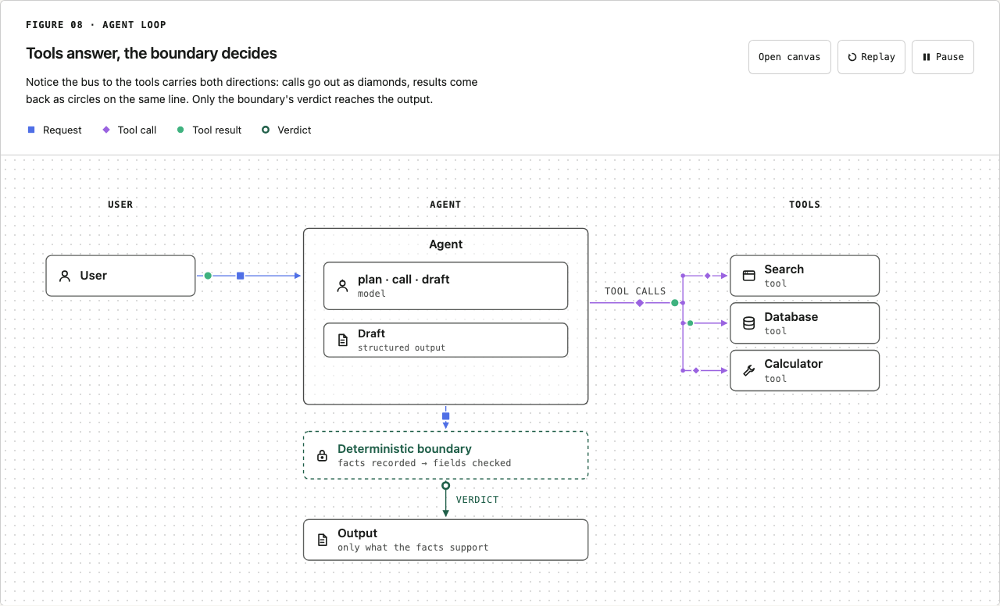

## Install

Not on npm yet (the bare name belongs to someone else's placeholder). Install from GitHub; `dist/` is committed so there is no build step on the consumer side.

```sh
npm install github:ong6/uipack
```

```tsx
import "uipack/theme.css";
import { Figure, Defs, Node, Connector, Packet, route } from "uipack";

const path = route([216, 60], [400, 140], "h"); // orthogonal, elbow at the midpoint

export function RequestFlow() {
  return (
    <Figure
      number="Figure 01"
      eyebrow="Request flow"
      title="One client, one service"
      caption="The client calls the service; the response rides the same path back."
      legend={[{ label: "Request", kind: "request" }, { label: "Response", kind: "response" }]}
      viewBox="0 0 640 200"
      alt="A client node on the left connected to a service node on the right.">
      <Defs id="rf" />
      <Node x={16} y={40} w={200} h={40} label="Client" icon="client" flow="call" />
      <Node x={400} y={120} w={200} h={40} label="Service" icon="service" flow="call" />
      <Connector points={path} defs="rf" kind="request" flow="call" />
      <Packet points={path} kind="request" dur={2} flow="call" />
      <Packet points={path} kind="response" dur={2} delay={-1} reverse flow="call" />
    </Figure>
  );
}
```

Separate entries, so a page loads only what it draws: `uipack` for parts, `uipack/presets` for ready figures, `uipack/charts` with `uipack/charts.css` for the span chart and layer stack, `uipack/article` with `uipack/article.css` for the labelled blocks of a long article, `uipack/presentations` for slide starters and speaker guides, `uipack/deck` with `uipack/deck.css` for the deck player, `uipack/web` with `uipack/web.css` for landing-page blocks, `uipack/mechanism` with `uipack/mechanism.css` for crafted isometric machines, and `uipack/browser` with `uipack/browser.css` for the asset browser.

`uipack/docs` with `uipack/docs.css` provides a product-documentation shell and Markdown renderer: grouped navigation, a 680px prose column, an h2/h3 table of contents, mobile disclosure, heading anchors, and previous/next links. See the [docs layout guide](docs/docs-layout.md) and the rendered `/docs` gallery entry.

`npm run dev` opens a playground with a two-row nav (groups, then the group's pages). Diagrams: `/` (also `/diagrams`) is the figure design system, each diagram pattern once from the bare canvas and the parts sampler to the drill-down (`/drill` opens it there), with when to use it and what it is built from; `/charts` the layer stack and span chart; `/article` the article parts in a host article. Presentations: `/deck` (the deck player, with `?deck=moves|bento|consulting`) and `/presentations` (slide starters and a complete narrative example). Motion & 3D: `/animations` (`/slides` remains an alias) and `/mechanism` (the Mechanism style's verification gate, its poses and thumbnails). Web: `/web` for the Landing building blocks and `/docs` for the documentation layout. Foundations: `/styles` indexes visual styles and `/assets` browses icons, marks, backgrounds and motion tokens.

## Charts

`uipack/charts` holds two article figures made of HTML and CSS, with no JavaScript needed in the browser: render them with `renderToStaticMarkup` and ship `uipack/charts.css`. Both use the site-diagram language: raised boxes with a 1.25px edge, tracked uppercase labels, dashed group boxes, and no outer frame.

- **SpanChart** places companies on the layers of a stack.
  - Each row's bar covers the layers the company works in, solid where its main business sits. Rows are grouped by main layer into a staircase and sorted largest first.
  - An unframed one-row key explains bars, deals, size and type. Readers filter by layer (a column heading), by size (a segmented control with counts) and by deals; the filters combine. They expand from the featured subset in place and open a row for its note and links.
  - Column labels go from codes on phones to short words at a 56rem figure width to full labels on wide screens.
- **LayerStack** walks a stack bottom-up, drawn top-down. Each band is a node that links to its section (a "↓" that reads "Go to section ↓" on hover and focus), inside a dashed zone box; on phones each band is one line. Bracket rails beside the stack (an "Across the stack" list on phones) cover the topics that span layers.

```tsx
import { renderToStaticMarkup } from "react-dom/server";
import { SpanChart } from "uipack/charts";
import "uipack/charts.css";

const html = renderToStaticMarkup(
  <SpanChart
    id="ai-stack"
    headingLevel="none"
    layers={[
      { id: "chips", label: "Chips and memory", short: "Chips", abbr: "CHP" },
      { id: "inference", label: "Inference", short: "Inference", abbr: "INF" },
    ]}
    tiers={[{ id: "large", label: "Large", range: "$50B+" }]}
    items={[{ id: "nvidia", name: "Nvidia", primary: "chips", also: ["inference"], featured: true, tier: "large", value: 4500, valueLabel: "$4.5T" }]}
  />,
);
```

Every behaviour is native `<details>`, radios, a reset button and CSS `:has()`, so static HTML works with JavaScript off. The optional `enhanceSpanChart(root)` adds:

- repeat-to-clear and Escape;
- live counts;
- scroll restoration;
- find-in-page for collapsed rows;
- links to a filtered view;
- a "Find a company" search over names, tags and deals;
- a column crosshair under a mouse pointer.

`enhanceLayerStack(root)` makes the band links scroll smoothly (not under reduced motion).

Colours follow the shared `--uipack-*` properties, light and dark. Bad data throws at render time, so a static build fails loudly. [SpanChart and LayerStack API, layouts and theming](docs/charts.md).

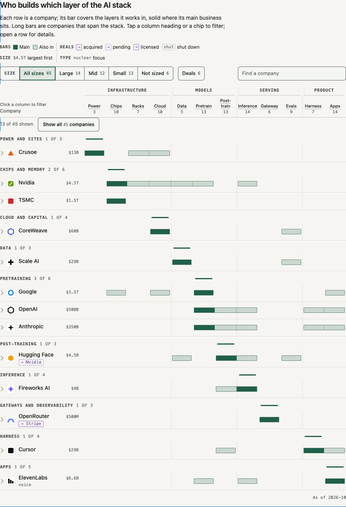
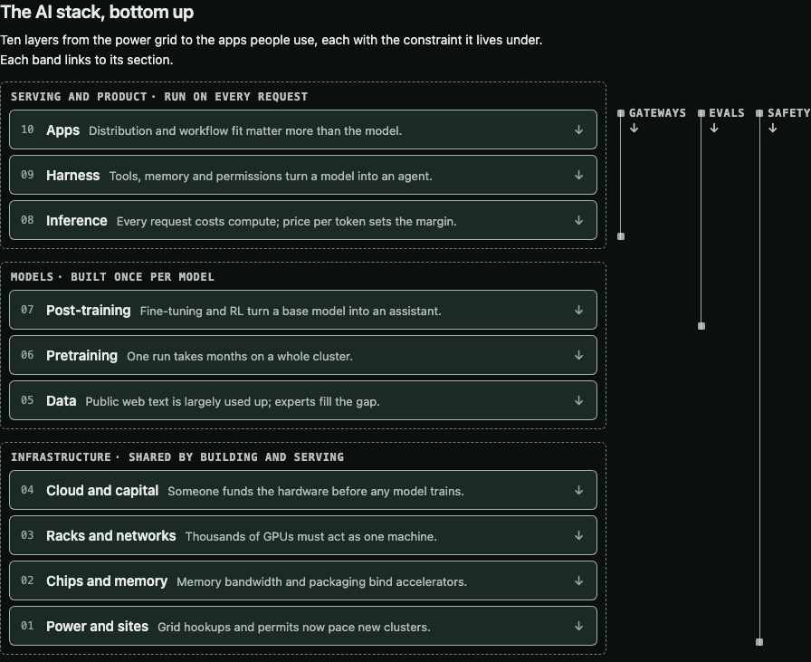

## Article parts

`uipack/article` holds the labelled blocks of a long article section, drawn in the figures' language (node boxes, uppercase labels, dashed groups, square markers). Like the charts they are plain HTML and CSS: render with `renderToStaticMarkup`, ship `uipack/article.css`, no JavaScript in the browser. Each part has a documented HTML and class contract, so a Markdown pipeline can emit the same markup without React.

- **NoteCard** is one link to the author's own article: kicker, title, a description clamped to three lines (still in the link's name), date and reading time, and a "→". A planned note is a dashed box that is not a link and says "Coming next".
- **NoteCluster** groups cards in a dashed box with a count. Its grid follows its own width: one column, two from 560px, three from 860px, cards in a row the same height. `wide` breaks out to the 56rem figure slot.
- **LayerHead** is a strip above a section's heading (the heading stays in the outline): index, zone, one key number, and "↑ Map" back to the diagram. One line from 560px; on phones the number wraps under.
- **TermList** ("Learn") is a plain inline list with a centred dot between terms; **Callout** marks a self-test question with a 3px accent rule; **ChangeNote** ("What changed") is quieter, with a thin ink rule and slightly smaller text; **LinkList** ("Go deeper") shows compact rows with each link's domain in mono. Only the cards, which are links, are drawn as boxes, and consecutive parts sit 0.9rem apart so they read as one block.

```tsx
import { Callout, LayerHead, NoteCluster, TermList } from "uipack/article";
import "uipack/article.css";

<LayerHead index={8} zone="Serving and product" metric={{ value: "~10 GB", label: "KV cache, one 32k chat" }} mapHref="#ai-stack-layers" />
<h3 id="inference">Inference</h3>
<TermList terms={["KV cache and PagedAttention", "continuous batching"]} />
<Callout kind="selftest">Why does one 32k-token conversation reduce how many users a GPU can serve at once?</Callout>
<NoteCluster label="My notes on serving and product" notes={[{ href: "/prefill-vs-decode", title: "Prefill and decode want different machines", description: "…", date: "2026-08-30", minutes: 7 }]} />
```

Colours follow the shared `--uipack-*` properties, light and dark; uppercase labels use `--uipack-label-font` (mono by default). [Article parts API, class contract and measurements](docs/article.md).

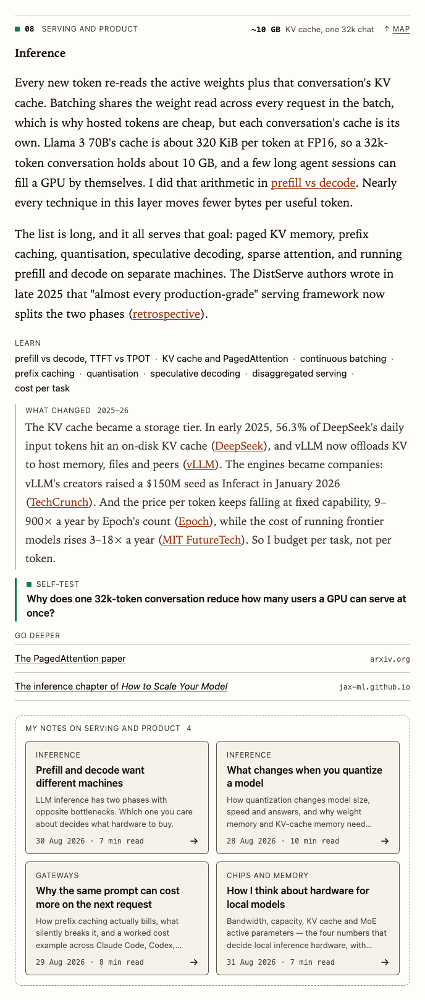
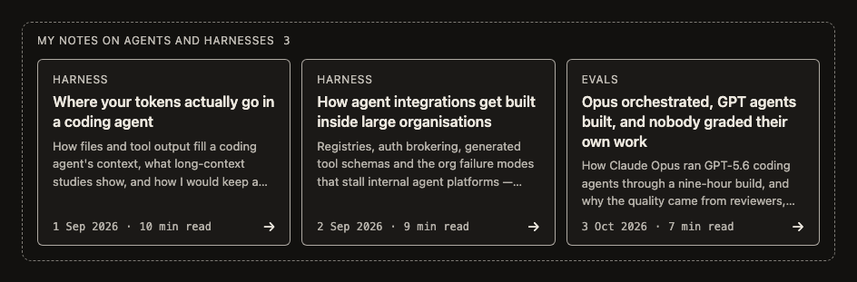

## 3D animations

An optional `uipack/slides` entry adds authored camera transitions, editable scene data, projected HTML labels, keyboard presentation controls, and a diagram fallback. It ships six examples: **Harness dive**, **Retrieval layers**, **Parallel agents**, **Quarter turn**, **Staged assembly**, and **Before / after**, with 23 directly addressable stops in total. Camera arcs, dolly moves, and staggered arrivals are configurable per stop.

```sh
npm install three@^0.186.0 gsap@^3.15.0
```

```tsx
import { SlidePlayer, harnessDive } from "uipack/slides";
import "uipack/slides.css";

<SlidePlayer story={harnessDive} theme="dark" />;
```

Use `SlideScene` with a controlled `stopId` to connect the persistent scene to another deck. Three.js and GSAP are optional peers and are not imported by the SVG figure entries. These are live browser presentations; native slide-file and video export are separate work.

[Slide API, story format, accessibility, and integration guide](docs/slides.md).

## Web UI

`uipack/web` is the Landing style: building blocks for landing pages and marketing sites, drawn from four design videos and written up as [numbered principles](docs/web-principles.md). The flashy pieces each earn their motion: **DemoPlayer** (a baked-in product demo that types a prompt, ticks through the agent's actions and settles on the result, with Pause, Replay and `01/02/03` step tabs), **StarHero** (one masked focal visual from the product story, with inline SVG noise), **SpotlightCard** (a pointer-following light and border glow, off on touch) and **RevealText** (a scroll-in word reveal). The low-key pieces are the defaults: a 16px × 1.25 type scale, `Eyebrow` / `Heading` / `Subhead` / `Body` with opacity hierarchy, `CtaButton`, a sticky `GlassNav`, and `Section` / `FeatureGrid` on a 12/8/4 grid with icons that rhyme with the hero.

```tsx
import "uipack/web.css";
import { WebSurface, GlassNav, StarHero, DemoPlayer, CtaButton, type DemoStep } from "uipack/web";

const steps: DemoStep[] = [
  { id: "ask", label: "Ask", title: "Say what you want.", prompt: "Clear my inbox. Keep only what needs me today." },
  { id: "act", label: "Act", title: "Watch it work.", actions: [{ label: "Archived newsletters", metric: 18 }, { label: "Drafted replies", metric: 3 }] },
  { id: "review", label: "Review", title: "Three things need you.", metric: 3, screen: <MyResult /> },
];

<WebSurface theme="dark">
  <GlassNav brand="Tidy" links={[{ label: "Pricing", href: "#pricing" }]} cta={<CtaButton href="#start">Start free</CtaButton>} />
  <StarHero title="Forty emails in. Three that need you." actions={<CtaButton size="lg" href="#start">Start free</CtaButton>}>
    <DemoPlayer label="Product demo" steps={steps} initialMetric={40} metricLabel="in your inbox" />
  </StarHero>
</WebSurface>;
```

**Motion** adds `Reveal` (staggered fade, rise or blur-in on scroll), `TextScramble` (scramble or typewriter, once), `NumberTicker` (counts proof stats up when seen), `Marquee` (pauses on hover, focus, off screen and with its own button), `TiltCard` and `MagneticButton` (mouse-only, subtle), `ScrollTransform` with `useScrollProgress` (reuse the hero's star as the reader scrolls), `withViewTransition` (View Transitions with an instant fallback) and `withPaintTransition(update, { duration })` (a theme change poured down the page as paint with random drips; 750ms by default; injects and removes its own keyframes and holds a `theme-switching` class on `<html>` that freezes element CSS transitions during the pour; instant fallback; wrap React state in `flushSync` yourself). **Backgrounds** add `GrainOverlay`, `DotGrid` and `LineGrid` (radial fade, optional pointer spotlight), `Aurora` (slow blurred token colours under one opacity cap), `MaskedStar` and `BeamLines` (light riding grid lines like packets); put one in a `BackgroundFrame`. `DriftingGutters` (`contentWidth`, `top`, `minViewport`, `drift`) is the exception: a fixed, page-level dotted grid drifting in the side gutters of a centred column, hidden below 1280px by default and coloured by `--web-gutters-color` (falling back to `--web-accent`); render it once per page, portalled to `<body>` if an ancestor is transformed. A page that uses nothing else from the web entry can import `uipack/web-gutters.css` (about 2 KB) instead of `uipack/web.css`. All of it is CSS, IntersectionObserver and inline SVG: no GSAP, no new dependencies. Moving pieces pause off screen and hold a static equivalent under reduced motion.

```tsx
<BackgroundFrame background={<DotGrid spotlight />}>
  <Reveal variant="blur">
    <Heading level={2}><TextScramble text="Forty in. Three left." /></Heading>
    <p><NumberTicker value={37} /> handled this morning</p>
  </Reveal>
</BackgroundFrame>
```

Every class and token is scoped under `.uipack-web`; there are no global element rules. Type comes in three self-hosted roles: Instrument Serif for display (headings at steps 4–6, the hero, big numbers), IBM Plex Sans for text and IBM Plex Mono for labels and data. They are latin woff2 files in `uipack/fonts/*` (141 KB in all, fetched only when used, no third-party requests); override `--web-font-display`, `--web-font-text` or `--web-font-mono` to change one. `<SmoothScroll />` is an opt-in, dependency-free Lenis-style wheel easing that moves the real page scroll (off on touch and under reduced motion) and eases in-page anchors below a sticky `GlassNav`; `smoothScrollTo(target, { offset, duration })` scrolls from code. See [type roles and smooth scrolling](docs/web-principles.md#type-roles). Under reduced motion, DemoPlayer lists all steps next to its final state, and the other pieces render still. `/web` in the playground composes a full example page.

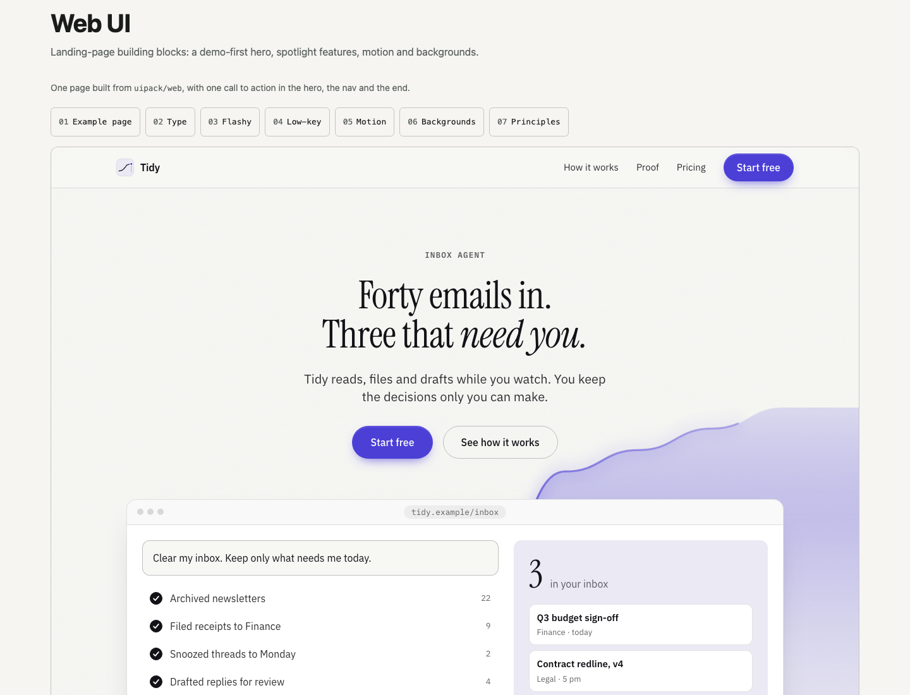
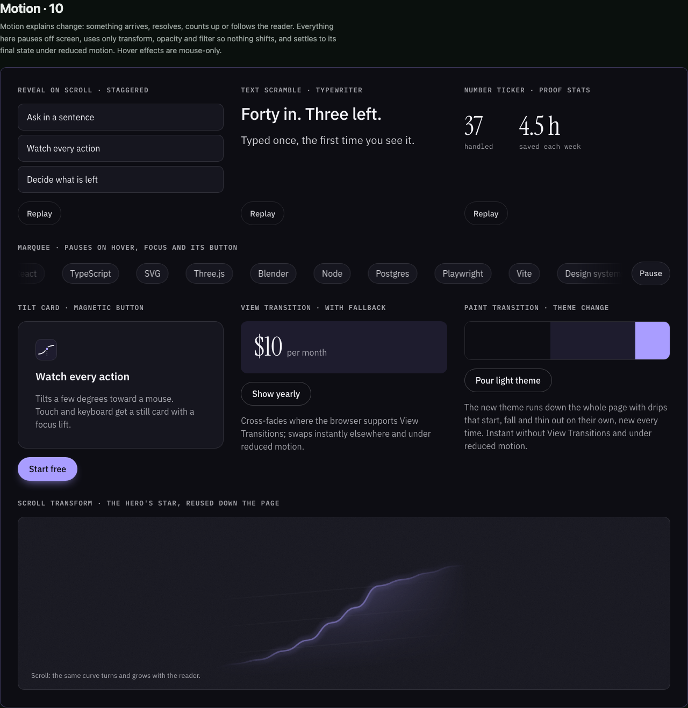
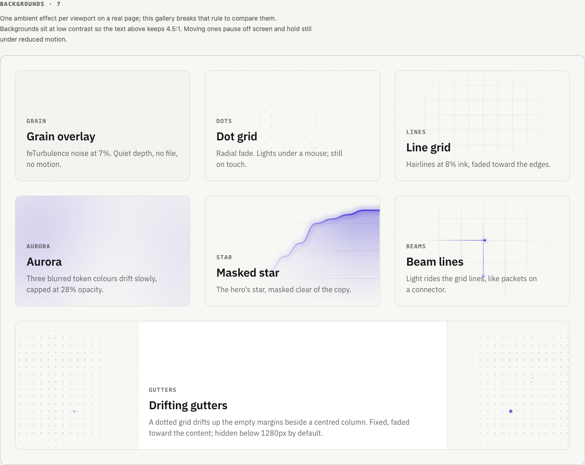

## Mechanism

`uipack/mechanism` is the Mechanism style: one real, well-made isometric machine whose working is the explanation, after [Anatomy](https://github.com/wheresryan22/anatomy) (MIT), drawn in the Technical palette. Its first machine, `VerificationGate`, is for an agent-harness talk: proposal tokens leave a hopper on a belt, a dial indicator measures each against a limit, passing ones drop into the result tray and failing ones are swung into a chute back to the hopper. A small pure model (`gate.ts`) drives the dial, the routes and the live readout (`checked 12 · passed 9 · returned 3`); the numbers are illustrative.

```tsx
import { VerificationGate } from "uipack/mechanism";
import "uipack/mechanism.css";

<VerificationGate pose="return" theme="dark" />            // idle | pass | return | apart, controlled per slide
<VerificationGate pose="pass" interactive={false} frame={false} /> // a still thumbnail, no loops
```

Pose changes move smoothly from wherever the machine is; it stops offscreen, holds a still frame under reduced motion, and works with tap, Space and Enter. SVG only, no Three.js. [Pose API, craft rules, how to build a new machine, and the licence](docs/mechanism.md).

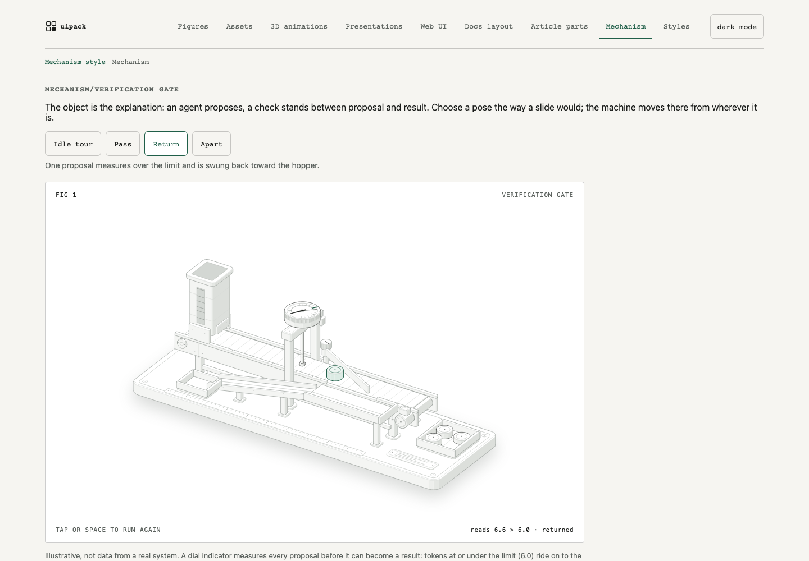

## Presentation starters

`uipack/presentations` exports typed Opening, Explanation, and System layouts. Each slide carries its visible content and a separate speaker guide with the words to say, a delivery cue, and an optional bridge. `SlideStarter` renders both; `renderSlideSvg` creates a self-contained editable 16:9 SVG without speaker notes.

[Presentation starter API and example](docs/presentations.md).

## Deck player

`uipack/deck` presents a deck consistently: a 1920×1080 canvas, one transition grammar (advance by default, morph for the same thing changing, zoom into a part), builds, an overview with a storyline view, full screen, a synced speaker window and a read view for phones and async readers. Slides carry a role and an action headline, and `lintDeck` checks the argument. [Deck player](docs/deck.md) · [Deck storytelling](docs/deck-storytelling.md).

## Parts

- `Figure`: the frame. Eyebrow, title (`headingLevel` picks the element), caption, legend, Pause and Replay, a canvas with a `background` of `dots`, `plain` or `ruled`, and a `narrow` drawing swapped in below 720px. Owns the SVG timeline, hover and selection state, and optional expanded canvas.
- `Lane`: mono uppercase column header, centred over `x..x+w`.
- `Group`: a boxed service (solid, centred title) or a dashed boundary (mono title).
- `Node`: a box with a label, a mono `sub`, an `icon`, an optional `hint` (one short sentence shown in a note beside the box when it is selected inside a Figure; a native tooltip elsewhere) and `href` (renders as a link with a focus ring). `Chip` and `Group` take the same `hint`.
- `Chip`: a pill for a connection slot, a queued item, a status flag.
- `Connector`: a rounded orthogonal path with one arrowhead.
- `Bus`: a trunk with stubs and a junction dot at each join. `busStub` and `busStubs` give the same points to packets.
- `Packet`: a token that rides a connector's points, looping.
- `Badge`, `Label`, `Legend`, `Token`, `Defs`: step numbers, text with an underlay, the key, the shape itself, the arrowhead markers.
- `icons`: 25 line glyphs in a 16px box (db, cache, queue, service, client, blob, agent, doc, model, tool, gateway, lock, key, clock, cron, browser, terminal, git, cloud, region, user, robot, chart, warning, more). `marks`: my own marks for the tool family, plus `Wordmark`.
- Geometry: `anchor`, `route`, `pathFromPoints`, `pointAlong`, `trim`, `polylineLength`, `grid`.

### The connector rule

One connector, one arrowhead, at the end, in the request direction. The response is the same points ridden backwards by a `Packet` with `reverse`. Two different relations between the same boxes (pull and push, say) are two connectors 16 units apart. A stub that joins a bus carries no arrowhead; the junction dot marks the join, and only a stub that enters a node gets a head.

Connectors stop 2 units short of their first and last point, and 4 short at the arrow end, so a head never touches a border. Packets start `r + 2` units after the source end and stop 12 before the arrowhead end, measured in the connector's own direction whichever way the packet rides, so a token never overlaps a border or a head. The browser suite checks both on every drawing in the playground.

## Interaction

Hover is opt-in and CSS-driven. Give parts a `flow` name (a string or a list): hovering a `Node` with a flow sets `data-hover-flow` on the figure, every element sharing that flow gets `data-state="hit"` (accent stroke, full opacity) and everything else `data-state="dim"` (opacity 0.35), with a 160ms transition. Hovering a legend item does the same by `kind`, so "Response" lights every response line and packet. A node on its own lifts its surface and turns its border accent on hover. Touch devices get none of it (`@media (hover: hover)`), and reduced motion drops the transition.

## Presets

Seven figures from a small typed spec, each with wide and narrow drawings, packets on the flows that matter, and hover flows wired. Import from `uipack/presets`; every preset ships a `default…` spec and a `…Parts()` function if you want the drawing without the frame.

| Preset | Spec | Shape |
|---|---|---|
| `serviceMap` | `clients`, `platform { title, cells, footer? }`, `resources`, `sinks?` | Three lanes, a bus each side, a change stream below. The Habitat shape. |
| `agentLoop` | `user`, `agent`, `tools`, `boundary`, `output` | Request in, tool calls out and results back, a deterministic check before the output. |
| `ragPipeline` | `sources`, `ingest`, `index`, `query`, `stages`, `answer` | Ingest lane on top writing to an index, query lane below reading from it. |
| `skillLifecycle` | `author`, `evaluate { baseline }`, `version`, `consumers`, `feedback` | Author, evaluate against a baseline, version, install everywhere, feedback back. |
| `syncLoop` | `upstream { items }`, `consumers [{ hooks?, plugin? }]` | One upstream, pull and push per consumer, a one-way plugin read. |
| `beforeAfter` | `before { stages }`, `after { stages, changed }` | Two stacked panels; the changed stage and its inbound edge in accent. |
| `pipeline` | `stages`, `queue? { after, depth }` | A line of stages with a queue between two of them. |

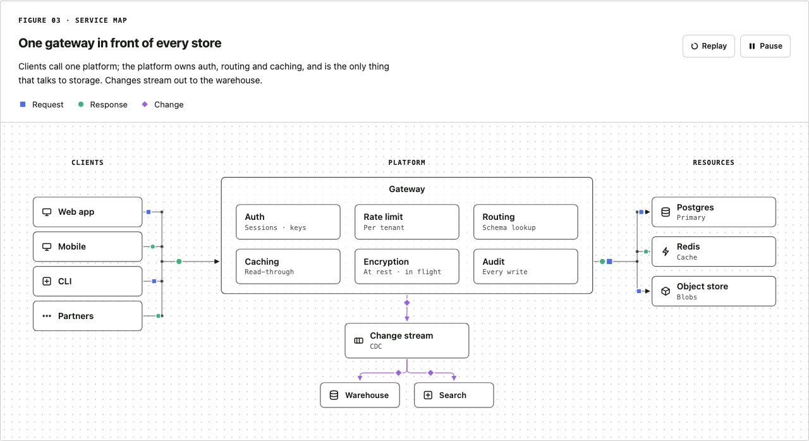
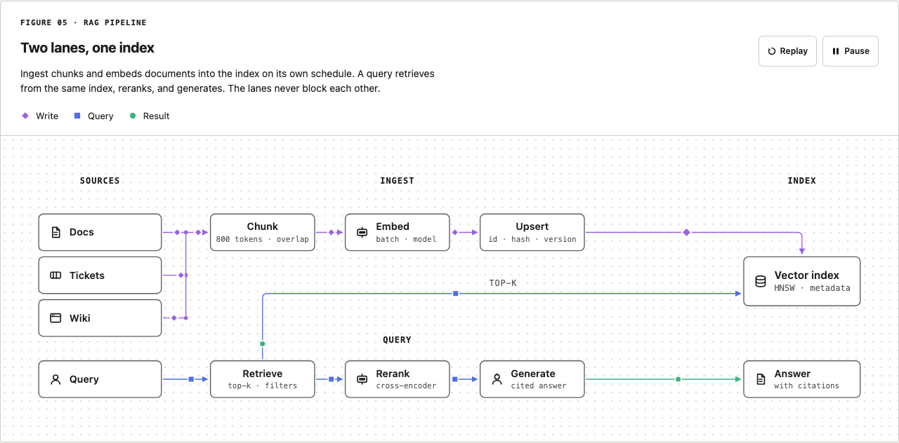
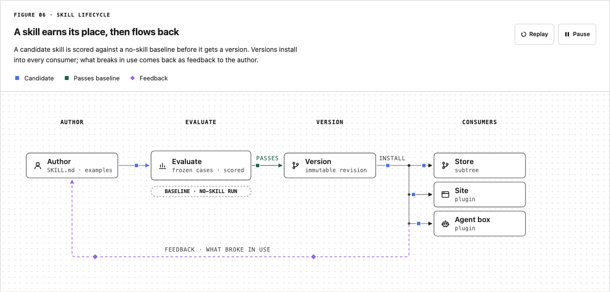
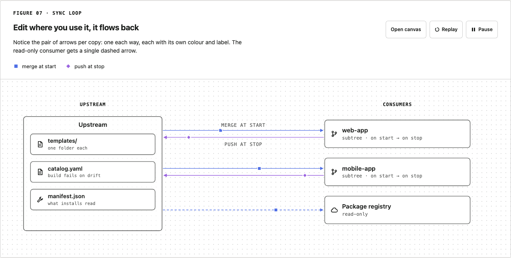
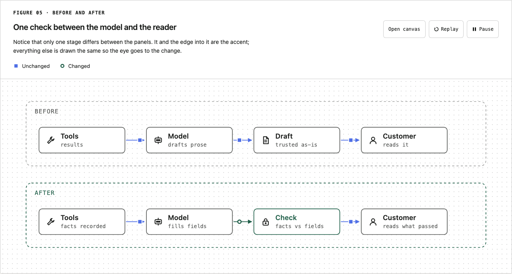
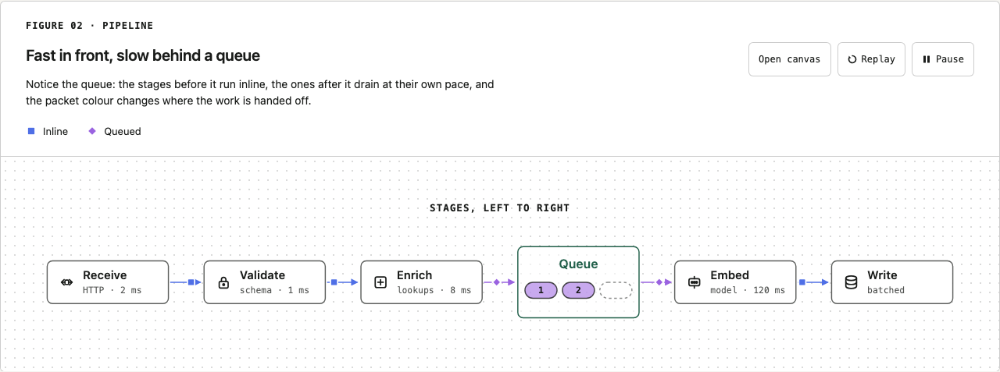

`examples/Habitat.tsx` stays as the reference drawing, built from the parts by hand; the diagrams page shows it as the service-map pattern. The page shows the pipeline, before-and-after, sync-loop and agent-loop presets as their patterns; the service-map, RAG-pipeline and skill-lifecycle presets draw shapes the page already covers (the Habitat drawing; a pipeline with a bus fan-in; a loop with a return path), so they are documented here only.

## Assets

`assets/manifest.json` lists every asset with a rendered preview under `docs/assets/` (light palette) and `docs/assets/dark/` (dark palette), and `AssetBrowser` (from `uipack/browser`) shows it: categories with counts down the left, a search box, a grid of cards with the preview on a tile that follows the theme, and one action, which copies the import line or the SVG. Names wrap rather than truncate.

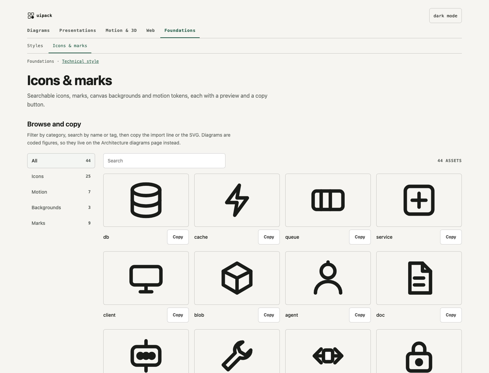

```json
{
  "version": 1,
  "generated": "2026-09-16",
  "assets": [
    {
      "id": "icon-lock",
      "name": "lock",
      "category": "Icons",
      "kind": "icon",
      "preview": "docs/assets/icon-lock.svg",
      "previewDark": "docs/assets/dark/icon-lock.svg",
      "source": "<Node … icon=\"lock\" />  // or: icons.lock",
      "tags": ["icon", "lock"]
    }
  ]
}
```

`kind` is one of `icon`, `motion`, `background`, `mark` (the type still accepts `figure` and `part` for older manifests). Today: 25 icons, 7 motion, 3 backgrounds, 9 marks. The diagram presets and parts are coded figures, not assets; see them on the playground's Architecture diagrams page. Marks are my own only; no third-party logos. `npm run manifest` re-renders the previews and rewrites the file.

```tsx
import "uipack/browser.css";
import { AssetBrowser } from "uipack/browser";
import manifest from "uipack/assets/manifest.json";

<AssetBrowser manifest={manifest} initialCategory="Icons" base="/uipack/" />
```

`onAction` replaces the copy, `actionLabel` renames the button. The sidebar collapses to a row of chips below 720px; every target is 44px. On wider screens the category list is sticky at `top: 16px`; a host with a fixed header sets `--uipack-browser-sticky-top` (for example `88px`) on `.uipack-browser` or an ancestor. The tile shows `previewDark` when the browser's colour tokens are dark (`data-theme="dark"` on it or an ancestor, or the OS preference without `data-theme="light"`).

## Static export

`uipack/static` turns a figure into one SVG file with no dependency on the page: every CSS variable
becomes a literal, fonts are declared inline, and the SMIL packets stay in when you want them. Made
for a README, a Markdown site or a slide, where the file goes through `` and `currentColor`
never reaches the drawing.

```ts
import { writeFileSync } from "node:fs";
import { agentLoop } from "uipack/presets";
import { renderStatic } from "uipack/static";

writeFileSync("figure.svg", renderStatic(agentLoop(spec), { theme: "dark", motion: true }));
```

| Option | Default | Does |
|---|---|---|
| `theme` | `"light"` | `"light"`, `"dark"`, or `{ base, ...overrides }` with any `--uipack-*` key as a literal |
| `motion` | `true` | keep `animateMotion` (it runs inside `` in every current browser) or render each packet once at its `at` |
| `frame` | `true` | draw eyebrow, title, caption, legend and the border in SVG; `false` gives the bare drawing |
| `background` | `true` | paint the canvas and dotted grid; `false` lets the page surface show through |
| `width` | viewBox width | the file's `width` attribute; height follows |
| `minFont` | `11` | text floor in CSS px at the width the file is shown at (1088 when `width` is not given) |

The input is what a preset returns, a `<Figure>` element, or a bare `{ children, viewBox }`. The
asset previews under `docs/assets/` come from the same call, so a preview in the browser and a file
in a README are the same pixels. Tested through `` in Chromium and WebKit: the packets move
when `motion` is on and hold still when it is off.

## Theming

Every colour is a CSS custom property on `.uipack`, so a host restyles by setting variables on any ancestor. Dark mode follows `prefers-color-scheme` and can be forced with `data-theme="dark"` on `<html>` or on the figure.

```css
.uipack {
  --uipack-fg: #1a1c1a;
  --uipack-bg: #ffffff;
  --uipack-surface: #ffffff;
  --uipack-surface-raised: #f4f6f4;
  --uipack-accent: #205f49;
  --uipack-token-request: #4f6fe6;
  --uipack-token-response: #3fb27f;
  --uipack-token-change: #9a63e0;
  --uipack-mono: ui-monospace, Menlo, monospace;
  --uipack-sans: system-ui, sans-serif;
}
```

Strokes are `currentColor`, so a figure inherits the page's text colour and one accent per figure does the highlighting.

## Motion

Packets animate with SMIL `animateMotion`. I picked SMIL over CSS `offset-path` because `Figure` can then drive the whole SVG timeline with `pauseAnimations()` and `setCurrentTime(0)`, which is what Pause and Replay do; every packet keeps its offset after a replay and nothing needs JavaScript per frame. Chromium and WebKit both pass the browser suite on it.

Under `prefers-reduced-motion: reduce` a packet renders once at `at` and never moves, and the controls disappear. `at` defaults to `(0.5 + delay / dur) mod 1`, so packets that share a path spread out instead of stacking on the midpoint. Server rendering also produces the static token; motion starts after mount.

### Text floor

`Figure` takes `minFont` (default 11 CSS px). It measures the width each drawing renders at with a ResizeObserver (1088 assumed before that, and on the server) and turns the floor into user units from the viewBox width, so Node, Lane, Label, Chip, Badge and Group never draw text under 11px however wide the viewBox is. Pass `measuredWidth` when you know the width up front, or `minFont={0}` to turn the floor off.

## Testing

`npm test` runs the Vitest suite in jsdom. `npm run test:e2e` runs Playwright in Chromium and WebKit with one worker (on port 5179; set `E2E_PORT` when a second checkout, such as a git worktree, runs its own server, or Playwright reuses the other checkout's), with one clipboard test skipped in WebKit because that engine cannot grant clipboard permissions. What they pin down:

- Packets move, hold after Pause, resume on Play, return to the start on Replay, and sit still under reduced motion.
- Hovering a node dims the rest and lights its flow. Hovering a legend item filters by kind. An `href` node takes focus.
- No arrowhead ends inside a node, no packet reaches a head, every bus junction and lane header sits on the 8px grid, and no preset text renders under 11px at 1440, on every drawing in the playground.
- Two packets on one path spread by delay; a departing token clears its source border; a serviceMap with six platform cells wraps its narrow drawing into rows of three and truncates with an ellipsis and a hint.
- The asset browser filters, searches, copies to the clipboard (Chromium only; Playwright cannot grant that in WebKit), and fits 390px with 44px targets.
- Both themes render ten figures with no console errors.
- Charts, in the playground's 896px host frame and at 720, 390 and 320:
  - SpanChart shows short layer names with counts at 896 and stacked rows at 720; its key strip is one row at 896 and 1088 with the notes site's longest words. It expands in place from the top or the foot, filters by column heading or chip (kept in sync), combines layer, size, deals and search, and shows a column band under the pointer.
  - It hides empty groups, clears from the empty state, opens rows with their links, honours repeat activation, Escape and hash links, and keeps collapsed rows findable in Chromium. The same flows work as static HTML with JavaScript off, including 160 rows.
  - A host article whose prose CSS loads after `charts.css` keeps every bar under its column.
  - After filtering from the stuck header deep in the list, or collapsing from the foot, the chart top and first result are on screen in Chromium and WebKit.
  - Stress rows (long names, long value labels, long buyer names) never crush a name or cut a badge, and column labels keep 8px apart in every label mode.
  - LayerStack reads top-down with one-line linked bands at 896, dashed zone boxes, bracket rails spanning exactly their layers, no rotated text and no outer frame. It never truncates a constraint, marks hover and focus with an accent edge, and turns rails into a list of nodes on phones.
  - Labels stay at 11px or more with 44px touch targets and no overflow.
  - Unit tests pin grouping, sorting, runs, the breakpoints, the scoped rules, screen-reader sentences, validation, and the 3:1 and 4.5:1 contrast of the cell and badge colours on four palettes.
- Article parts, in the playground's host article and as static HTML (JavaScript off) in a copy of the notes site's article layout and palette, at 390, 896 and 1440 in both themes: no page overflow; one, two or three cluster columns by the cluster's own width; equal card heights in every row; a wide cluster centred on the column; text at 12px or more; 4.5:1 text and 3:1 edges computed from the rendered colours; 44px link targets; the strip's one-line and phone layouts; only cards are filled boxes, the self-test's 3px accent rule against ChangeNote's thinner ink rule, the sentence-case metric label, and 0.9rem between consecutive parts. Cards, rows and the map link are real links that navigate (a planned card is not), keyboard focus draws an accent ring and accent title, hover an accent edge, reduced motion drops the transitions, and host prose CSS loaded after `article.css` does not reach in. Unit tests pin the markup, the accessibility attributes, validation, and that every emitted class is documented in `docs/article.md` and styled, with nothing else styled.
- Live 3D stories retain one canvas across stops, support direct navigation and reduced motion, and provide a diagram fallback.
- `/web`: DemoPlayer advances when in view, holds after Pause, restarts on Replay, seeks from keyboard step tabs, and renders statically under reduced motion; the spotlight follows the mouse and lights on keyboard focus; both themes fit 390px with 44px targets and no console errors. Motion and backgrounds: the ticker counts only once seen, reveals play, the marquee moves and holds on Pause and hover, aurora and beams pause off screen, the dot grid lights under the mouse, and all of it holds still under reduced motion. Unit tests pin the type scale and compute the 4.5:1 contrast of the Landing tokens, including text over the aurora at its opacity cap.
- `/mechanism`: the verification gate renders in both themes with no console errors; changing the pose moves the token; reduced motion holds a still frame; the machine is reachable and operable from the keyboard; every drawn line ends on a stroke or a dot (Anatomy's line-end check); thumbnails start no loops. Unit tests pin the gate model, the continuity of every scripted route, unique SVG ids per instance and the vendored licence.
- Object art directions cover every combination of six objects, six directions, two themes, and two viewport widths. Each combination has its own test, screenshot, and render-cost attachment. All 30 non-Studio object/direction pairs also retain their geometry and paint-rate budgets, sampled inside the browser after playback starts.

CI runs both suites with job timeouts. Browser jobs split each engine into four shards with one worker per runner, so software WebGL renderers do not compete for CPU and a retry repeats only the failed case. Linux Chromium runs ANGLE with Mesa llvmpipe under Xvfb: its default SwiftShader Subzero backend missed the existing frame-rate budget on the CI CPU. Renderer names are included in the performance samples. The 15-minute job limit and default 30-second test limit stay bounded. Reports, screenshots, budget measurements, and functional-test retry traces are uploaded for seven days. Timing tests disable trace/video recording to keep measurements independent of capture overhead. Reproduce an art-direction failure with `npx playwright test e2e/art-directions.spec.ts --project=chromium --workers=1 --retries=0`; add `--grep` with its object/direction name to isolate it. Playwright is locked at 1.61.1 because the 1.63 browser build would not download on my network. Bump it when that clears.

On macOS, this WebKit build can stop navigating on the 64th fresh browser context, including on the root page; the Linux CI runner does not show this limit. Run the affected WebKit suite in three fresh processes: `for shard in 1 2 3; do npx playwright test e2e/art-directions.spec.ts --project=webkit --workers=1 --retries=0 --shard=$shard/3 || break; done`. Each shard contains at most 60 cases. For larger local WebKit runs, inspect `--list --shard=N/M` and use enough shards to keep each process at 63 cases or fewer.

## Roadmap

- Stepped stories for the SVG figures (live 3D slide stories are available now).
- Counters and stat tiles on nodes (the "3 concurrent requests" pattern).
- Export to PNG and video for slides.
- Integrate the optional live 3D scenes into selected website pages.

## Credit

The look is OpenAI's, from the Habitat post linked above. The idea of typed, validated figures comes from [archify](https://github.com/tt-a1i/archify). The asset browser follows the shape of Rubric Elements. The primitives grew out of the diagrams on junxiong.dev.

MIT.

## More from ong6

- [groundplane](https://github.com/ong6/groundplane) — fails the build when an agent asserts a fact its tools never produced
- [skills](https://github.com/ong6/skills) — the public Claude Code and Codex skills, including skillsmith, interview-prep and the field-engineering deck and pilot-evidence skills

## Design and contribution guidance

Read [AGENTS.md](AGENTS.md) before editing. [CLAUDE.md](CLAUDE.md) points to that same canonical guide. Charts: [docs/charts.md](docs/charts.md). [Design direction](docs/design-direction.md) defines the Technical style, catalog taxonomy, mobile behaviour, and presentation composition. Browse the [documentation index](docs/README.md), [source guide](src/README.md), and [playground guide](playground/README.md).

Figures support tap/keyboard selection and Open canvas with bounded pinch zoom, a zoom percentage, and keyboard controls. 3D animations have component inspection and their own canvas workspace. See [interaction details and limits](docs/interaction.md). Content type and visual style are separate. Implemented styles are Technical, Landing (`uipack/web`), Mechanism (`uipack/mechanism`), and the six object art directions.

## Significant UI and object scenes

Follow [the component-first workflow](docs/component-first.md) for substantial visuals. The optional [`uipack/objects`](docs/objects.md) entry provides seven object scenes with three curated looks each, shared playback and fallbacks. Tennis is authored in Blender and played through Three.js.
