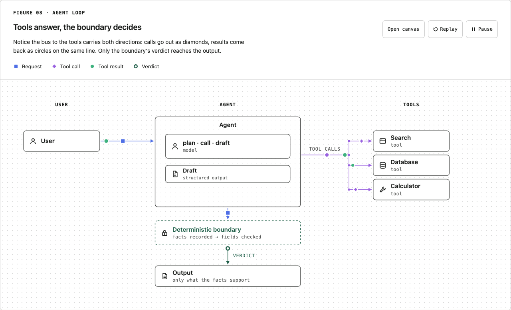

# uipack

Jun Xiong's own design system: the diagrams, decks, web pages, motion and 3D he uses on his sites
(the [uipack docs site](https://ui.junxiong.dev), [junxiong.dev](https://junxiong.dev), [notes.junxiong.dev](https://notes.junxiong.dev))
and in work presentations, so they look consistent and explain things the way he likes. It is
built for agents to read and build from, not as a public product: React and SVG components plus
the rules for writing and laying them out, all in Markdown that ships with the package.



## Start here (agents)

| Your job | Read, in order |
| --- | --- |
| Build a page or deck for a site | [uipack-page](skills/uipack-page/SKILL.md) |
| Draw a diagram | [uipack-diagram](skills/uipack-diagram/SKILL.md) |
| Write slide, web or figure copy | [uipack-copy](skills/uipack-copy/SKILL.md) |
| Write or update a site's spec | [uipack-spec](skills/uipack-spec/SKILL.md) |
| Review or grade work before handing off | [uipack-review](skills/uipack-review/SKILL.md), then [docs/grading/README.md](docs/grading/README.md) |
| Know the read order and what's fixed for every site vs set per site | [docs/agents/README.md](docs/agents/README.md) |
| Look up a rule (style, writing, layout) | [docs/system/README.md](docs/system/README.md), then only your medium's file |
| Look up a component's props | The entry's doc in the table below |
| Change uipack itself | [AGENTS.md](AGENTS.md) |
| See every doc with a one-line summary | [llms.txt](llms.txt) (generated) or [docs/README.md](docs/README.md) |
| Browse the docs with their live demos | [ui.junxiong.dev](https://ui.junxiong.dev) (Docs), [ui.junxiong.dev/gallery](https://ui.junxiong.dev/gallery) (Assets) |

Inside a site, read the same files from `node_modules/uipack/`. They match the installed code. The [docs site](https://ui.junxiong.dev) renders `main` and serves each file as Markdown at its repo path ([`/llms.txt`](https://ui.junxiong.dev/llms.txt), [`/docs/agents/README.md`](https://ui.junxiong.dev/docs/agents/README.md)), for an agent without a checkout.

## Install

The package isn't on npm. Each release attaches its built package to the GitHub release as `uipack-<version>.tgz`; a site installs that file, so there is no build step on its side. The line for the latest release:

<!-- generated:install -->
```sh
npm install https://github.com/ong6/uipack/releases/download/v0.4.0/uipack-0.4.0.tgz
```
<!-- /generated -->

uipack is ES modules only (since 0.4.0): `import` it from a bundler (Next.js, Vite) or a Node ESM script; there is no CommonJS build. Git pins up to `v0.3.0` (`github:ong6/uipack#v0.3.0`, or a commit before it) keep working, because those commits carry the built `dist/`; later commits do not, so pin a release tarball. How a release is cut and how a site moves to one: [releases](docs/releases.md).

```tsx
import "uipack/theme.css";
import { Figure, Defs, Node, Connector, Packet, route } from "uipack";

const path = route([216, 60], [400, 140], "h"); // orthogonal, elbow at the midpoint

export function RequestFlow() {
  return (
    <Figure
      number="Figure 01"
      eyebrow="Request flow"
      title="One client, one service"
      caption="The client calls the service; the response rides the same path back."
      legend={[{ label: "Request", kind: "request" }, { label: "Response", kind: "response" }]}
      viewBox="0 0 640 200"
      alt="A client node on the left connected to a service node on the right.">
      <Defs id="rf" />
      <Node x={16} y={40} w={200} h={40} label="Client" icon="client" flow="call" />
      <Node x={400} y={120} w={200} h={40} label="Service" icon="service" flow="call" />
      <Connector points={path} defs="rf" kind="request" flow="call" />
      <Packet points={path} kind="request" dur={2} flow="call" />
      <Packet points={path} kind="response" dur={2} delay={-1} reverse flow="call" />
    </Figure>
  );
}
```

## Entries

Each entry is imported on its own, so a page loads only what it draws. Three.js and GSAP are
optional peers, used only by `uipack/objects` and `uipack/slides`. `react-markdown` and
`remark-gfm` are optional peers, used only by `uipack/docs`.

| Import | What it draws | Reference |
| --- | --- | --- |
| `uipack` + `uipack/theme.css` | Figure parts: frame, lanes, groups, nodes, connectors, moving packets, drill-down | [Figure parts API](docs/figure-api.md), [catalogue](docs/diagrams.md), [drill](docs/drill.md) |
| `uipack/presets` | Seven ready figures from a typed spec | [Presets](docs/figure-api.md#presets) |
| `uipack/static` | One self-contained SVG file from a figure | [Static export](docs/figure-api.md#static-export) |
| `uipack/charts` + `.css` | SpanChart and LayerStack, static HTML | [Charts](docs/charts.md) |
| `uipack/article` + `.css` | Labelled blocks for a long article | [Article parts](docs/article.md) |
| `uipack/web` + `.css` | Web pages: hero, product surfaces, sections, motion, backgrounds, SEO helpers | [Web parts API](docs/web-api.md), [principles](docs/web-principles.md), [discoverability](docs/web-discoverability.md) |
| `uipack/deck` + `.css` | The deck player: 1920×1080 slides, transitions, speaker view, `lintDeck` | [Deck player](docs/deck.md), [storytelling](docs/deck-storytelling.md) |
| `uipack/presentations` + `.css` | Editable SVG slide starters with speaker guides | [Presentation starters](docs/presentations.md) |
| `uipack/mechanism` + `.css` | Isometric machines driven by a pose | [Mechanism](docs/mechanism.md) |
| `uipack/objects` + `.css` | Lazy 3D object scenes and their art directions | [Objects](docs/objects.md) |
| `uipack/slides` + `.css` | 3D camera stories (`SlidePlayer`). The name is historical and kept for existing imports | [3D stories](docs/slides.md) |
| `uipack/docs` + `.css` | A documentation shell and Markdown renderer | [Docs layout](docs/docs-layout.md) |
| `uipack/browser` + `.css` | The asset browser | [Icons and marks](docs/icons-and-marks.md) |
| `uipack/grade` | Tier-1 page checks, judge packets and tallies (Node only; CLI `npx uipack-grade`) | [Grading](docs/grading/README.md) |
| `uipack/styles.css` | The role layer alone | [Style roles](docs/system/style.md) |

## Style

There is one implemented style, **Technical** ("Cyanotype": Prussian-blue ink on a cool white
sheet, one amber accent, IBM Plex Sans and Mono). Every colour, face, radius and ornament is a
`--ui-*` role, so components never hold a literal. Components offer named looks: diagrams use the fixed **Blueprint** look on every site
([component looks](docs/components/README.md)). Each site gets its own spec, written from
[the template](docs/specs/README.md). The [site registry](docs/specs/registry.md) lists every
site, its spec and the uipack commit it pins.

## Develop

```sh
npm run dev            # the docs site: every page renders a Markdown file from docs/
npm run build:site     # the static docs site Vercel deploys to ui.junxiong.dev (playground/dist)
npm run check:site     # crawl that build with vercel.json's headers: every route, link and request
npm run build          # writes dist/ (gitignored); tests and the typecheck read it
npm run verify         # format check, typecheck, lint, unit tests for what changed
npm run test:affected -- --e2e  # browser tests for what changed; CI runs everything
```

The full pre-commit list is in [AGENTS.md](AGENTS.md#engineering-and-verification). What each suite covers: [testing](docs/testing.md). How to add a part, page, style or entry:
[contributing](docs/contributing.md).

## Credit

The figure look started from OpenAI's [Habitat post](https://openai.com/index/scaling-storage-one-billion-users-part-one/).
Typed, validated figures come from [archify](https://github.com/tt-a1i/archify). The asset browser
follows Rubric Elements. The mechanism kit is vendored from Anatomy (MIT, see
`src/mechanism/kit/LICENSE`). MIT licence.
