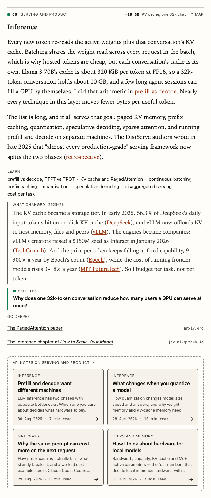
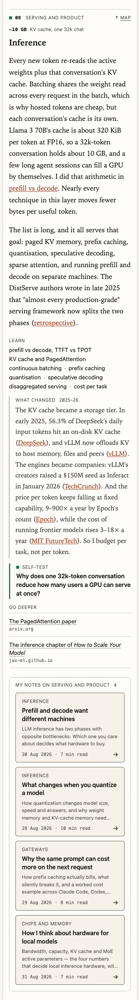
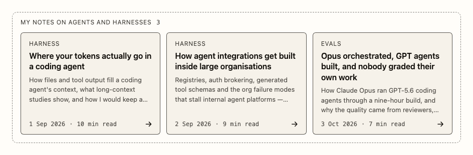
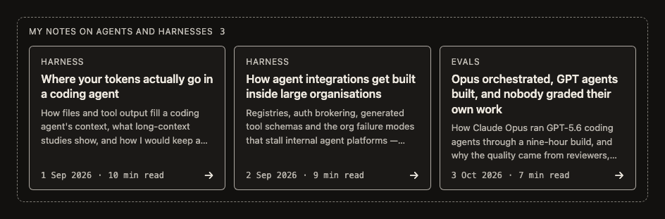

# Article verification

How `uipack/article` is tested, the section rhythm measured on a real article, and screenshots of
the parts at 390 and 896 in both themes. The parts themselves are in [Article parts](article.md).

## Tests

- Unit tests (`test/article.test.tsx`): markup, class contract against this file and the stylesheet, accessibility attributes, validation errors, no hooks.
- Browser tests (`e2e/article.spec.ts`), Chromium and WebKit: the playground at 390, 896 and 1440 in both themes; a static page rendered with `renderToStaticMarkup` in a copy of the notes site's article layout and palette, with JavaScript off. They check page overflow, the grid's columns, equal card heights in a row, 44px targets, focus rings, contrast from computed colours, links, and that host prose CSS does not leak in.

| Light | Dark |
| --- | --- |
|  |  |
|  |  |

## Section rhythm

Measured on the Inference section of the static notes-layout fixture (`scripts/build-article-fixtures.tsx`), in Chromium, from the top of its LayerHead to the top of the next one. The Learn row became text, the self-test lost its box, and consecutive parts moved to 0.9rem apart:

| Viewport | Section before | Section after | TermList to LinkList before | after |
| --- | --- | --- | --- | --- |
| 1440 (664px column) | 1674.2px | 1555.5px | 649.8px | 531.1px |
| 390 (350px column) | 2673.6px | 2493.5px | 978.9px | 797.7px |
