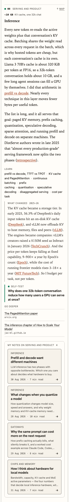
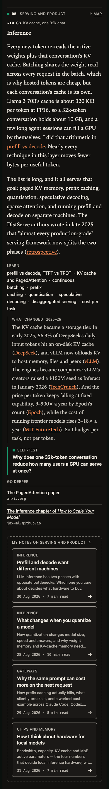
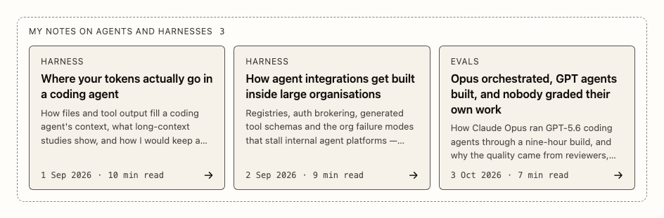

# Article parts

`uipack/article`, with its stylesheet `uipack/article.css`, provides the labelled blocks of a long article section, drawn in the same language as the SVG figures:

- **NoteCard** links to one of the author's own articles. **NoteCluster** groups cards in a dashed box with a responsive grid.
- **LayerHead** is a compact strip above a section heading: index, zone, one key number and a link back to the map.
- **TermList** ("Learn"), **Callout** (a self-test), **ChangeNote** ("What changed") and **LinkList** ("Go deeper") replace bold-label paragraphs that otherwise all look the same.

Every part is plain markup: no hooks, no context, no JavaScript in the browser. `renderToStaticMarkup` output works without hydration and in a server component. Each part has a fixed HTML and class contract (below), so a host can emit the same markup from a Markdown pipeline (a rehype plugin) instead of React. The unit tests check that every class the components emit is documented here and styled, and that the stylesheet styles nothing else.

```tsx
import { renderToStaticMarkup } from "react-dom/server";
import { Callout, ChangeNote, LayerHead, LinkList, NoteCluster, TermList } from "uipack/article";
import "uipack/article.css"; // once per page, or copy dist/article.css

const html = renderToStaticMarkup(
  <>
    <LayerHead index={8} zone="Serving and product" metric={{ value: "~10 GB", label: "KV cache, one 32k chat" }} mapHref="#ai-stack-layers" />
    <h3 id="inference">Inference</h3>
    {/* …the section's prose… */}
    <TermList terms={["KV cache and PagedAttention", "continuous batching", "prefix caching"]} />
    <ChangeNote kicker="2025–26">The KV cache became a storage tier. …</ChangeNote>
    <Callout kind="selftest">Why does one 32k-token conversation reduce how many users a GPU can serve at once?</Callout>
    <LinkList links={[{ href: "https://arxiv.org/abs/2309.06180", title: "The PagedAttention paper" }]} />
    <NoteCluster label="My notes on serving and product" notes={[{ href: "/prefill-vs-decode", title: "Prefill and decode want different machines", description: "…", date: "2026-08-30", minutes: 7, kicker: "Inference" }]} />
  </>,
);
```

The playground renders every part on `/article`, inside a 40rem prose column with blog-like prose CSS; `?host=notes` maps the tokens to the notes site's palette. The example content is the Inference and Harness sections of [The AI stack, one constraint per layer](https://notes.junxiong.dev/ai-stack-roadmap), in [`examples/articleParts.tsx`](../examples/articleParts.tsx).


## Visual language

| Mark | Drawn as | Used by |
| --- | --- | --- |
| Node box | `--uipack-surface-raised` fill, 1.25px edge at 70% ink, `--uipack-radius` (6px). Reserved for links. | NoteCard |
| Title | sans 600, 16px | NoteCard title, self-test question |
| Sub-label | 13px at 75% ink, sentence case | NoteCard description, cluster note, LayerHead metric label |
| Label | uppercase, 12px, letter-spacing 0.06em, 80% ink, `var(--uipack-label-font, var(--uipack-mono))` | every part except the metric label |
| Accent rule | 3px accent on the left, no fill, no other edge | Callout (self-test) |
| Ink rule | 1.25px at 70% ink on the left, no fill | ChangeNote |
| Inline list | 15px text, a centred `·` between items drawn in CSS | TermList |
| Numbers | mono | dates, minutes, counts, index, metric value, domains |
| Group | dashed 1.25px box at 50% ink, 10px radius, label inside at the top left | NoteCluster |
| Planned | dashed edge | NoteCard `status="planned"` |
| Marker | 8px square, 1.5px radius, accent | LayerHead index, self-test label |
| Emphasis, hover, focus | accent edge and accent title; focus adds a 2px accent ring | NoteCard, links |

Ink steps are `color-mix()` of `--uipack-fg` with transparent. Contrast, checked against the Technical palette and the notes site's in both themes: text at least 4.78:1 (accent title on the raised surface; ChangeNote's body at 85% ink is above 10:1), node edges at least 6:1, the self-test's accent rule at least 5.2:1, the dashed group edge at least 3.2:1. The group edge is 50% ink rather than the SVG groups' 40% so it clears 3:1.

## Theming and host setup

The parts read only `--uipack-*` custom properties, each with a Technical fallback that switches with `[data-theme="dark"]` or the OS setting, like `theme.css`:

| Token | Used for |
| --- | --- |
| `--uipack-fg` | ink; every ink step derives from it |
| `--uipack-surface-raised` | node fill |
| `--uipack-accent` | markers, emphasis, hover and focus |
| `--uipack-sans`, `--uipack-mono` | type |
| `--uipack-label-font` | uppercase labels (default mono; the notes site maps it to sans) |
| `--uipack-radius` | node radius (6px) |
| `--uipack-article-gap` | space above and below each block (1.5rem) |
| `--uipack-article-step` | space between consecutive TermList, ChangeNote, Callout and LinkList (0.9rem) |
| `--uipack-article-wide` | width of a wide cluster (min(56rem, 100vw − 2.5rem)) |

A host maps its palette on any ancestor of the parts. The notes site does this in its `.fig-html` block for charts; the article parts need the same mapping on the article (for example on `.prose`), or the parts fall back to the Technical palette.

Three rules reach outside a part, on purpose:

- `.uipack-layerhead + h1…h6` sets the heading's top margin to 4px, so the strip sits on its heading.
- TermList, ChangeNote, Callout and LinkList that follow each other read as one block: `--uipack-article-step` (0.9rem) apart, with the full `--uipack-article-gap` (1.5rem) above the first and below the last. This uses `:has()`; a browser without it keeps 1.5rem between them.
- `.uipack-cluster--wide` sets its own width and a negative left margin, centring it on the text column, like the notes site's `.fig-media`.

Host prose rules (`.prose p`, `.prose ul`, `.prose li`, `.prose a`) do not reach the parts' own elements, whichever stylesheet loads last: every rule names two classes. Content passed in as children (links, emphasis, code in a Callout, ChangeNote or LinkList body) keeps the host's styling. ChangeNote's body also keeps the host's prose font.

Motion is a 160ms colour change and a 3px arrow nudge on hover, only under `prefers-reduced-motion: no-preference`. In forced-colours mode the markers draw in `CanvasText` and focus rings in `Highlight`.

## Class contract

Markup is shown as `renderToStaticMarkup` emits it, reformatted. Required parts are marked; anything else may be left out. A host emitting the markup itself must keep the element types, the `role` and `aria-hidden` attributes, and the spaces between sibling spans inside a link (they keep words apart in its accessible name; layout ignores them). Arrows, the `·` separator and markers are CSS, not text.

### NoteCard

```html
<a class="uipack-notecard" href="/prefill-vs-decode">
  <span class="uipack-notecard__kicker">Inference</span>
  <span class="uipack-notecard__title">Prefill and decode want different machines</span>
  <span class="uipack-notecard__desc">LLM inference has two phases…</span>
  <span class="uipack-notecard__meta">
    <time class="uipack-notecard__date" datetime="2026-08-30">30 Aug 2026</time>
    <span class="uipack-notecard__time">7 min read</span>
    <span class="uipack-notecard__go" aria-hidden="true">→</span>
  </span>
</a>

<!-- status="planned": not a link, dashed -->
<div class="uipack-notecard uipack-notecard--planned">
  <span class="uipack-notecard__kicker">Harness</span>
  <span class="uipack-notecard__title">…</span>
  <span class="uipack-notecard__desc">…</span>
  <span class="uipack-notecard__meta"><span class="uipack-notecard__status">Coming next</span></span>
</div>
```

| Class | Element | Notes |
| --- | --- | --- |
| `uipack-notecard` | `a[href]` (required) | The whole card is one link. Its text, including the full description, is its accessible name. |
| `uipack-notecard--planned` | modifier on a `div` | Dashed edge, no link, no hover. |
| `uipack-notecard__kicker` | `span` | Label style, e.g. the layer. Optional. |
| `uipack-notecard__title` | `span` (required) | Not a heading: cards stay out of the page outline. |
| `uipack-notecard__desc` | `span` | Clamped to three lines on screen with `-webkit-line-clamp`; the text stays in the DOM. |
| `uipack-notecard__meta` | `span` (required) | Pinned to the card's bottom, so cards in a row align. |
| `uipack-notecard__date` | `time[datetime]` | Printed "30 Aug 2026" (`formatNoteDate`). A `·` separates it from the time. |
| `uipack-notecard__time` | `span` | "7 min read". |
| `uipack-notecard__go` | `span[aria-hidden="true"]` | The "→"; accent and nudged on hover. |
| `uipack-notecard__status` | `span` | Planned only: "Coming next", label style. |

Props: `href`, `title`, `description`, `date?` (ISO), `minutes?`, `kicker?`, `status?: "published" | "planned"`, `plannedLabel?` ("Coming next"), `minutesLabel?` ("min read"), `id?`, `className?`. A published card without `href` throws.

### NoteCluster

```html
<div class="uipack-cluster uipack-cluster--wide">
  <p class="uipack-cluster__head">
    <span class="uipack-cluster__label">My notes on serving and product</span>
    <span class="uipack-cluster__count" aria-hidden="true">4</span>
  </p>
  <p class="uipack-cluster__note">Optional line.</p>
  <ul class="uipack-cluster__grid" role="list">
    <li class="uipack-cluster__item"><a class="uipack-notecard" href="…">…</a></li>
  </ul>
</div>
```

| Class | Element | Notes |
| --- | --- | --- |
| `uipack-cluster` | `div` (required) | Dashed group box and the size container (`container: uipack-cluster / inline-size`). |
| `uipack-cluster--wide` | modifier | Width `--uipack-article-wide`, centred on the text column: the 56rem figure slot. |
| `uipack-cluster__head` | `p` (required) | Label and count on one line. |
| `uipack-cluster__label` | `span` (required) | Label style. |
| `uipack-cluster__count` | `span[aria-hidden="true"]` | Mono. Hidden from screen readers because the list announces its length. |
| `uipack-cluster__note` | `p` | Optional sub-label, 13px at 75% ink. |
| `uipack-cluster__grid` | `ul[role="list"]` (required) | `role="list"` keeps list semantics in Safari once `list-style` is removed. |
| `uipack-cluster__item` | `li` (required) | One card per item; the card fills the row's height. |

Grid: one column; two from 560px of cluster width; three from 860px (container queries on the cluster's content box, 525px and 825px). Cards in a row share its height, and each card's meta line sits on its bottom edge. Measured in Chromium (WebKit matches; the e2e tests hold both to these rules):

| Where | Cluster width | Columns | Card width | Card heights |
| --- | --- | --- | --- | --- |
| Playground text column, 40rem | 640px | 2 | 297px | 183.7px; four cards, two rows, all equal |
| Notes site text column, 44rem less padding | 664px | 2 | 309px | 183.7px; with a planned card, its row 205.3px, both equal |
| `wide`, 56rem slot (1440px viewport) | 896px | 3 | 279.3px | 205.3px (agents) or 183.7px (serving), equal per row |
| `wide` at an 896px viewport (slot is 100vw − 2.5rem) | 856px | 2 | 405px | 183.7px and 162.1px rows, equal per row |
| Phone, 390px viewport | 324–350px | 1 | 290–316px | each card its own height |

Props: `label`, `note?`, `notes?: NoteCardProps[]` or NoteCard `children`, `count?: number | false`, `wide?`, `id?`, `className?`.

### LayerHead

```html
<div class="uipack-layerhead">
  <div class="uipack-layerhead__row">
    <p class="uipack-layerhead__where">
      <span class="uipack-layerhead__index"><span class="uipack-layerhead__sr">Layer </span>08</span>
      <span class="uipack-layerhead__zone">Serving and product</span>
    </p>
    <p class="uipack-layerhead__metric">
      <span class="uipack-layerhead__value">~10 GB</span>
      <span class="uipack-layerhead__label">KV cache, one 32k chat</span>
    </p>
    <a class="uipack-layerhead__map" href="#ai-stack-layers">Map</a>
  </div>
</div>
<h3 id="inference">Inference</h3>
```

| Class | Element | Notes |
| --- | --- | --- |
| `uipack-layerhead` | `div` (required) | Hairline rule on top; the size container. Not a heading: the `h3` after it stays in the outline. |
| `uipack-layerhead__row` | `div` (required) | The grid. One line from 560px; narrower, the metric moves under the index and zone, and the map link stays top right. |
| `uipack-layerhead__where` | `p` (required) | Index and zone. |
| `uipack-layerhead__index` | `span` (required) | Mono 600, after an accent square marker. |
| `uipack-layerhead__sr` | `span` | Visually hidden "Layer " read before the number. |
| `uipack-layerhead__zone` | `span` | Label style. |
| `uipack-layerhead__metric` | `p` | Optional. |
| `uipack-layerhead__value` | `span` | Mono 600. |
| `uipack-layerhead__label` | `span` | Sentence case, 13px sans at 75% ink, not tracked, so units keep their case ("32k", "TB/s"). |
| `uipack-layerhead__map` | `a[href]` | Text "Map"; CSS draws the "↑" (not underlined, not read). 44px target. |

Props: `index` (a number is padded: 8 → "08"), `zone?`, `metric?: { value, label? }`, `mapHref?`, `mapLabel?` ("Map"), `indexLabel?` ("Layer"), `id?`, `className?`.

### TermList

```html
<div class="uipack-terms">
  <p class="uipack-terms__label">Learn</p>
  <ul class="uipack-terms__list" role="list">
    <li class="uipack-terms__term">continuous batching</li>
    <li class="uipack-terms__term">prefix caching</li>
  </ul>
</div>
```

| Class | Element | Notes |
| --- | --- | --- |
| `uipack-terms` | `div` (required) | |
| `uipack-terms__label` | `p` (required) | Label style. |
| `uipack-terms__list` | `ul[role="list"]` (required) | A plain inline list, 15px sans, not chips. |
| `uipack-terms__term` | `li` (required) | Inline text, no border or fill. Every term after the first gets a centred `·` from CSS (not read aloud); no space touches the dot, so it never starts or ends a line, and lines break inside terms. Not a link. |

Props: `terms`, `label?` ("Learn"), `id?`, `className?`.

### Callout

```html
<div class="uipack-callout uipack-callout--selftest">
  <p class="uipack-callout__label">Self-test</p>
  <div class="uipack-callout__body">Why does one 32k-token conversation…?</div>
</div>
```

| Class | Element | Notes |
| --- | --- | --- |
| `uipack-callout` | `div` (required) | Not a box (the filled node box means a link): no fill, no edge but a 3px rule on the left. |
| `uipack-callout--selftest` | modifier | Accent rule, square marker before the label; the body is set like a node title (sans 600, 16px), a question to answer before moving on. |
| `uipack-callout--note` | modifier | Generic aside: a 3px rule at 50% ink, no marker, body 15px regular. |
| `uipack-callout__label` | `p` (required) | "Self-test" or "Note", label style. |
| `uipack-callout__body` | `div` (required) | Inline children; host link and code styles apply. |

Props: `kind?: "selftest" | "note"` (default selftest), `label?`, `children`, `id?`, `className?`.

### ChangeNote

```html
<div class="uipack-change">
  <p class="uipack-change__label">What changed <span class="uipack-change__kicker">2025–26</span></p>
  <div class="uipack-change__body">The KV cache became a storage tier. …</div>
</div>
```

| Class | Element | Notes |
| --- | --- | --- |
| `uipack-change` | `div` (required) | Quieter than a Callout: no fill, a 1.25px rule at 70% ink on the left. The weight and the colour of the rule tell it from a self-test's 3px accent rule. |
| `uipack-change__label` | `p` (required) | Label style. |
| `uipack-change__kicker` | `span` | Mono, not uppercase, 75% ink. |
| `uipack-change__body` | `div` (required) | The host's prose font at 0.94em, ink at 85%; links keep the host's colour. |

Props: `label?` ("What changed"), `kicker?`, `children`, `id?`, `className?`.

### LinkList

```html
<div class="uipack-links">
  <p class="uipack-links__label">Go deeper</p>
  <ul class="uipack-links__list" role="list">
    <li class="uipack-links__item">
      <a class="uipack-links__link" href="https://arxiv.org/abs/2309.06180">
        <span class="uipack-links__title">The PagedAttention paper</span>
        <span class="uipack-links__domain">arxiv.org</span>
      </a>
    </li>
  </ul>
  <div class="uipack-links__body">Inline fallback…</div>
</div>
```

| Class | Element | Notes |
| --- | --- | --- |
| `uipack-links` | `div` (required) | The size container. |
| `uipack-links__label` | `p` (required) | Label style. |
| `uipack-links__list` | `ul[role="list"]` | Rows between hairlines. |
| `uipack-links__item` | `li` | |
| `uipack-links__link` | `a[href]` | 44px row. Title left, domain right; below 420px of width the domain moves under the title. |
| `uipack-links__title` | `span` | Underlined; accent on hover and focus. |
| `uipack-links__domain` | `span` | Mono, 75% ink. From `linkDomain(href)` ("www." dropped); none for relative links. Inside the link, so it is part of the name. |
| `uipack-links__body` | `div` | Inline children: after the rows, or instead of them when links cannot be split out. |

Props: `label?` ("Go deeper"), `links?: { href, title, domain?: string | false }[]`, `children?`, `id?`, `className?`. A list with neither links nor children throws.

## Section rhythm

Measured on the Inference section of the static notes-layout fixture (`scripts/build-article-fixtures.tsx`), in Chromium, from the top of its LayerHead to the top of the next one. The Learn row became text, the self-test lost its box, and consecutive parts moved to 0.9rem apart:

| Viewport | Section before | Section after | TermList to LinkList before | after |
| --- | --- | --- | --- | --- |
| 1440 (664px column) | 1674.2px | 1555.5px | 649.8px | 531.1px |
| 390 (350px column) | 2673.6px | 2493.5px | 978.9px | 797.7px |

## Helpers

- `formatNoteDate("2026-08-30")` → "30 Aug 2026", read as a calendar date (no time zone shift); anything else is returned unchanged.
- `linkDomain(href)` → the host name without "www.", or `undefined` for relative, hash and non-http links.
- `layerIndex(8)` → "08".

They have no React dependency in their logic, so a rehype plugin can import them and print exactly what the components print.

## Verification

- Unit tests (`test/article.test.tsx`): markup, class contract against this file and the stylesheet, accessibility attributes, validation errors, no hooks.
- Browser tests (`e2e/article.spec.ts`), Chromium and WebKit: the playground at 390, 896 and 1440 in both themes; a static page rendered with `renderToStaticMarkup` in a copy of the notes site's article layout and palette, with JavaScript off. They check page overflow, the grid's columns, equal card heights in a row, 44px targets, focus rings, contrast from computed colours, links, and that host prose CSS does not leak in.

| Light | Dark |
| --- | --- |
|  |  |
|  |  |
