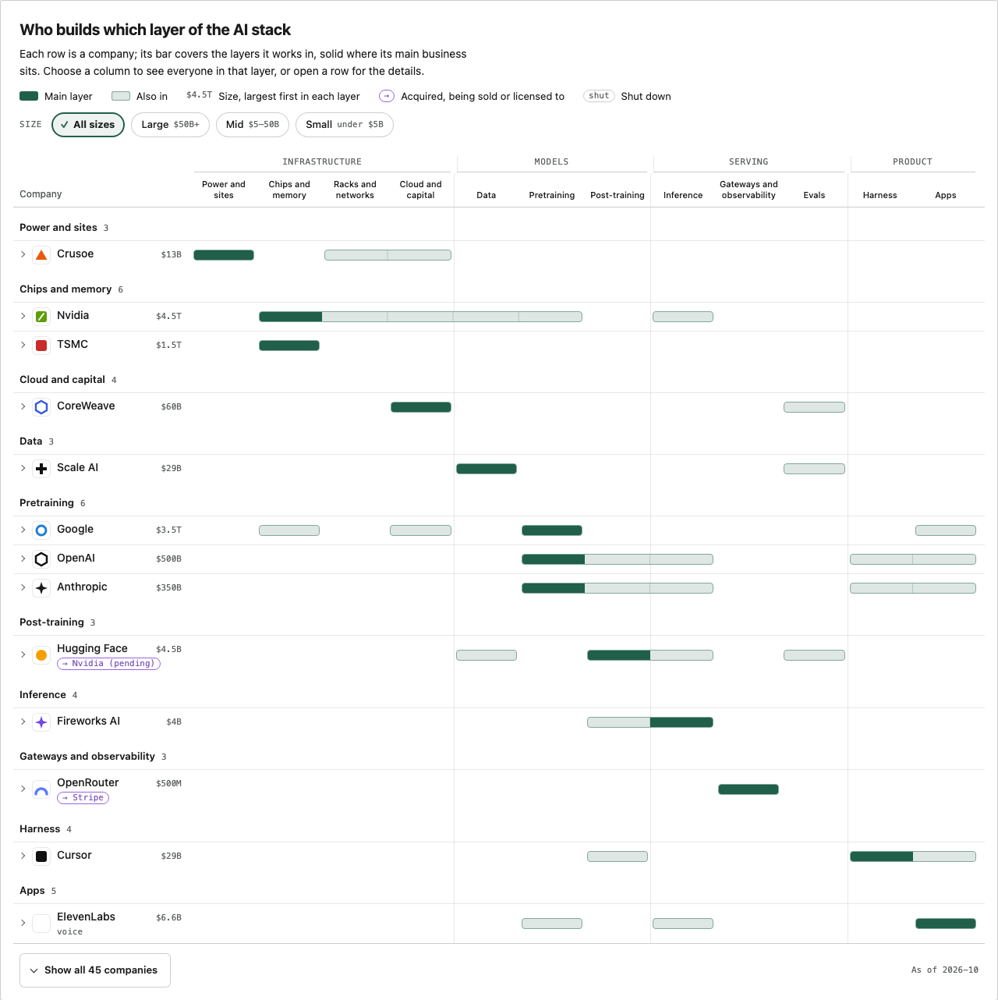
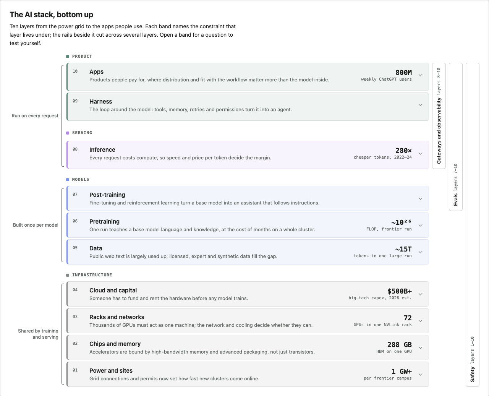

# Charts: SpanChart and LayerStack

`uipack/charts` with `uipack/charts.css` holds two article figures built from HTML and CSS rather than SVG: **SpanChart**, a sideways bar chart that places items on the layers of a stack, and **LayerStack**, a stacked-layer diagram that walks a stack from the bottom up. Neither imports Three.js or GSAP, and neither needs JavaScript in the browser. Every behaviour is native form state (`<details>`, radios, a checkbox) plus CSS (`:has()`, `:checked`, container queries). So the output of `renderToStaticMarkup` works without hydration, and the same markup works when React renders it on the client.

```tsx
import { renderToStaticMarkup } from "react-dom/server";
import { LayerStack, SpanChart } from "uipack/charts";
// Ship this stylesheet once on the page (import it, or copy dist/charts.css).
import "uipack/charts.css";

const html = renderToStaticMarkup(
  <>
    <LayerStack {...stack} />
    <SpanChart {...chart} />
  </>,
);
```

Each SpanChart carries a small scoped `<style>` element with its own filter rules, keyed by its `id`, so give every chart on a page a unique `id`. The playground renders both on `/` with the AI-stack example in [`examples/aiStack.ts`](../examples/aiStack.ts).



## SpanChart

Rows are items; columns are ordered layers (left = bottom of the stack). Each item has one primary layer and zero or more other layers. A row draws one rounded bar per contiguous run of covered layers: the primary cell is solid accent, the others are a pale tint with a hairline accent border, and gaps stay empty. Rows are grouped by primary layer in column order, so the chart reads as a staircase, and a long bar marks an item that spans many layers. Add rows by adding data; the chart is tested with 160 rows.

```ts
interface SpanLayer { id: string; label: string; abbr: string; zone?: string } // abbr: a short code, e.g. "INF"
interface SpanZone { id: string; label: string }                               // header band over consecutive columns
interface SpanTier { id: string; label: string; range?: string }               // e.g. { id: "mid", label: "Mid", range: "$5–50B" }
interface SpanStatus { kind: "acquired" | "pending" | "licensed" | "shutdown"; label?: string } // label: "Stripe, 2026"
interface SpanItem {
  id: string; name: string; primary: string; also?: string[];
  logo?: string;       // image URL; missing gives a monogram tile
  href?: string;       // website, linked as "Website" in the opened row
  note?: string;       // one sentence shown when the row is opened
  status?: SpanStatus; // badge under the name
  tags?: string[];     // short mono tags under the name
  featured?: boolean;  // in the initial subset
  source?: string;     // URL backing the placement, linked as "Source"
  tier?: string;       // one of the chart's tiers
  value?: number;      // sort key, largest first (e.g. valuation in USD billions)
  valueLabel?: string; // short display text, e.g. "$17.5B" or "—"
}
interface SpanChartProps {
  id: string;                        // unique on the page, no spaces
  layers: SpanLayer[]; zones?: SpanZone[]; items: SpanItem[];
  tiers?: SpanTier[];                // largest first; adds the size filter
  title?: ReactNode; caption?: ReactNode; asOf?: string;
  initial?: "featured" | "all";      // default "featured" when any item is featured
  groupBy?: "primary" | "none";      // default "primary"
  labels?: Partial<SpanChartLabels>; // every visible word; see SPAN_CHART_LABELS
  headingLevel?: 2 | 3 | 4 | 5;      // title level; group headings one below. Default 3
}
function SpanChart(props: SpanChartProps): JSX.Element;
function enhanceSpanChart(root: HTMLElement): () => void; // optional; returns cleanup
```

Within a group, rows sort by `value` (largest first, rows without a value last), then by name. The consumer computes `tier`, `value` and `valueLabel`; the chart only displays, sorts and filters.

**Subset and expand.** With any featured item, only featured rows show at first. A footer control (a `<label>` around a visually hidden, focusable checkbox) reads "Show all 45 companies" / "Show the 13 featured", with the counts computed from the data. Expanding reveals the other rows in place inside their groups. Group headings show the layer name and its total count. `initial="all"` starts expanded. If no item is featured, or every item is, there is no control.

**Layer filter.** Each column header is a `<label>` for a radio in one group, plus an "All layers" radio checked by default. Choosing a layer tints its column down the whole chart, marks the header with a 3px bar and bold text (not colour alone), shows every row that touches the layer, featured or not, and hides groups with no match. While a layer is chosen, the first-column header reads "× All layers" and clears the filter.

**Size filter.** With `tiers`, a row of chips ("All sizes", then each tier with its range) works the same way: radios inside labels, a check mark and a heavier border on the selected chip. Layer and size combine (AND). Any active filter shows every matching row, hides groups without one, hides the expand control and shows "14 of 45 in Inference · Small" in the footer. If a combination matches nothing, a short message replaces the rows.

**Row detail.** Each row is a `<details>`. Its `<summary>` is the row (name cell and bar track) on the same grid as the headers. Opening it shows the full name, the note, the layers in words, the size, the status in words, and the "Website" and "Source" links, which stay ordinary links. Each summary has one visually hidden sentence, such as "Fireworks AI. Main layer: Inference. Also in: Post-training. Size: $4B, Small.", and its drawn cells are `aria-hidden`.

**enhanceSpanChart** (optional) adds the design-direction behaviour: activating the selected header or chip again (click, tap, Space or Enter) clears that filter, and Escape clears both. Escape is heard on the document while focus is in the chart or the chart was the last thing clicked, because Safari does not focus a radio when its label is clicked. Enter also selects a header or chip, and a polite live region announces the filtered count. Everything else works without it. On a static page:

```js
import { enhanceSpanChart } from "uipack/charts";
document.querySelectorAll(".uipack-span").forEach((el) => enhanceSpanChart(el));
```

**Layout.** The chart root is a size container.

- At 640px or wider, a 220px name column (logo tile, name, value label right-aligned, with any badge and tags on a second line) sits beside the layer columns. The columns share the rest equally, under an optional zone band with zone separators carried down the grid.
- Column headers show the full labels, centred on at most two lines, once they fit. The breakpoint is computed from the labels: first at 11px, then at 12px. Below it they show the `abbr` codes in mono, with a key that maps codes to labels.
- Below 640px each row stacks: the name line, with the value beside the name, then a full-width bar track under codes. The filter tint is drawn per track there, so it never crosses the names.
- Rows are about 36px tall (44px with a badge line), and the column header row is sticky.

Every label is at least 11px, and nothing overflows the page at 390px.

**Status badges.** `acquired` → "→ Stripe", `pending` → "→ Nvidia (pending)", `licensed` → "→ Nvidia (licensed)", in the change colour; `shutdown` → "shut", muted. Screen readers hear "Acquired by Stripe, 2026", "Sale agreed to Nvidia, 2026", "Technology licensed to Nvidia, 2025" and "Shut down".

**Logos.** Logos sit on a light neutral tile with a hairline border in both themes, slightly dimmed in dark mode, because favicons are often dark glyphs on transparent ground. Images load with `loading="lazy"`, `decoding="async"` and empty alt text, since the name is adjacent. A missing logo gives a one- or two-letter mono monogram ("OpenRouter" → "OR").

**Validation.** Validation always runs, not only in development, so a static build fails loudly. It throws on: unknown layer ids in `primary` or `also`, duplicate item, layer or tier ids, unknown tiers, a status other than `shutdown` without a label, zones that do not cover consecutive layers, and an `id` with spaces. Each message names the chart and the item, for example `SpanChart "ai-stack": item "x" lists unknown layer "nope" in \`also\`. Known layers: …`.

`buildSpanModel(props)` and `spanChartCss(model)` expose the computed groups, counts and scoped rules for tests or custom rendering.

## LayerStack

A hero diagram for an article that walks a stack bottom-up. The first layer is drawn at the bottom. Each layer is a full-width band with its number (01 at the bottom), name, one-line summary (its constraint) and an optional metric in mono, right-aligned. Bands are grouped by zone under a zone label, with a larger gap between zones and a subtle tint per zone. The tints come from the existing muted, request, change and accent tokens, so there is no new palette.

```ts
interface StackZone { id: string; label: string }
interface StackLayer {
  id: string; label: string; zone: string;
  summary: string;                          // one line: the constraint
  metric?: { value: string; label: string };
  detail?: string;                          // shown when opened, e.g. a self-test question
  href?: string;                            // the article section, "Read the section →"
}
interface StackRail { id: string; label: string; from: string; to: string; summary?: string; href?: string }
interface StackBracket { label: string; from: string; to: string }
interface LayerStackProps {
  id: string; title?: ReactNode; caption?: ReactNode;
  zones: StackZone[];
  layers: StackLayer[];                     // bottom to top
  rails?: StackRail[];                      // cross-cutting columns on the right
  brackets?: StackBracket[];                // annotations on the left
  labels?: Partial<LayerStackLabels>;
  headingLevel?: 2 | 3 | 4 | 5;
}
```

- **Bands** with `detail` or `href` are `<details>`. Opening one shows "Check yourself" and the question, plus "Read the section →" when `href` is set. Bands with neither are plain.
- **Rails** are vertical bars in a right-hand column. One CSS grid places them over exactly their layers' rows, labelled bottom-to-top with their range ("Evals · layers 7–10"). With `href` a rail is a link, and hovering or focusing it shows its `summary` beside it.
- **Brackets** are thin bracket lines with a label in a narrow left column.
- **Below 640px**, brackets become small labels above the zone they start in, rails become a list of chips under the stack ("Across layers"), and each metric moves under its summary.
- **Validation:** unknown zones, rails or brackets that name an unknown layer, a zone split by another zone, and duplicate ids all throw.

The DOM order is bottom-up, the same as the numbers, so screen readers and the Tab key walk the stack the way the article does, while the grid draws it top-down.



## Theming

Both components read the shared `--uipack-*` properties with the Technical defaults and theme switching of `theme.css`: `prefers-color-scheme` unless `data-theme="light"` is on `<html>`, and `data-theme="dark"` on an ancestor or the root. Each value falls back to the default for the current theme, so a host remaps colours by setting the variables on any ancestor, and its own light/dark switching flows through.

| Property | Used for |
|---|---|
| `--uipack-fg`, `--uipack-muted` | text, secondary text |
| `--uipack-bg`, `--uipack-surface`, `--uipack-surface-raised` | page, controls, hover and opened rows |
| `--uipack-border` | frame, header rules, chips |
| `--uipack-accent` | primary cells, tints, selection, links, focus rings |
| `--uipack-token-change` | status badges; LayerStack's third zone tone |
| `--uipack-token-request` | LayerStack's second zone tone |
| `--uipack-sans`, `--uipack-mono` | type (system fonts by default; no font requests) |
| `--uipack-span-name-width` | SpanChart's name column (220px) |
| `--uipack-span-sticky-top` | offset of the sticky header under a fixed site header (0px) |
| `--uipack-span-tint`, `--uipack-span-hairline` | the "also" cell tint and row separators (derived from accent and fg by default) |
| `--uipack-span-logo-bg`, `--uipack-span-logo-filter` | the logo tile (white; pale and `brightness(0.92)` in dark) |

```css
/* e.g. a site whose own tokens already switch with its theme */
.article-figure {
  --uipack-fg: var(--text);
  --uipack-muted: var(--muted);
  --uipack-bg: var(--bg);
  --uipack-surface: var(--bg);
  --uipack-surface-raised: var(--surface);
  --uipack-border: var(--faint);
  --uipack-accent: var(--accent);
  --uipack-sans: var(--sans);
  --uipack-mono: var(--mono);
}
```

All rules are scoped under `.uipack-span` and `.uipack-stack`. Neither stylesheet has a global element rule. Both reset margins on their own headings, paragraphs and lists, so prose styles such as `.prose p` do not leak in. Transitions are 120ms chevron turns, disabled under `prefers-reduced-motion`.

## Limits

- A browser without `:has()` shows every row with the filters inert (Chrome 105, Safari 15.4 and Firefox 121 have it). Without container queries, the narrow layout is used at every width. Tints use `color-mix()`.
- Safari moves Tab focus only to links and text fields unless full keyboard access is on, so the radios and checkbox are reachable there with Option-Tab. That is the platform default.
- The full-label breakpoint is estimated from a system-sans width table. A much wider host font can wrap a column label to a third line, but never clips it.
