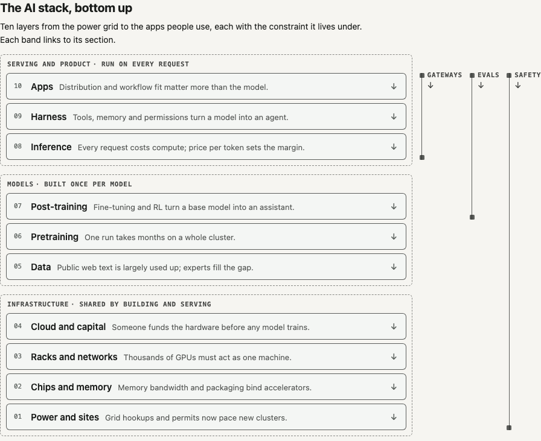

# Charts: SpanChart and LayerStack

`uipack/charts`, with its stylesheet `uipack/charts.css`, provides two article figures built from HTML and CSS rather than SVG:

- **SpanChart** is a sideways bar chart that places items on the layers of a stack.
- **LayerStack** is a stacked-layer diagram that walks a stack from the bottom up.

Neither imports Three.js or GSAP, and neither needs JavaScript in the browser. Every behaviour is native form state (`<details>`, radios, checkboxes and a reset button) plus CSS (`:has()`, `:checked` and container queries). The output of `renderToStaticMarkup` therefore works without hydration, and the same markup works when React renders it on the client.

```tsx
import { renderToStaticMarkup } from "react-dom/server";
import { LayerStack, SpanChart } from "uipack/charts";
// Ship this stylesheet once on the page (import it, or copy dist/charts.css).
import "uipack/charts.css";

const html = renderToStaticMarkup(
  <>
    <LayerStack {...stack} headingLevel="none" />
    <SpanChart {...chart} headingLevel="none" />
  </>,
);
```

Each SpanChart carries a small scoped `<style>` element with its own filter and layout rules, keyed by its `id`. Give every chart on a page a unique `id`.

The playground renders both on `/` inside a frame at a host's real figure width: 896px by default, or `?frame=720|390|320|full`. The data is the AI-stack example in [`examples/aiStack.ts`](../examples/aiStack.ts).


## SpanChart

Rows are items, and columns are ordered layers, with the bottom of the stack on the left. Each item has one primary layer and zero or more other layers.

- **Bars.** A row draws one rounded bar per contiguous run of covered layers. The primary cell is solid accent, the other cells are a tint with an accent edge, and gaps stay empty.
- **Groups.** Rows are grouped by primary layer in column order, so the chart reads as a staircase. An accent tick under each group heading marks the group's own column, so the staircase reads even when a group shows one row.
- **Order.** Within a group, rows sort by `value` (largest first, rows without a value last), then by name.
- **Scale.** Add rows by adding data. The chart is tested with 160 rows, and each row costs about 0.9–1.2 KB of HTML.

```ts
interface SpanLayer {
  id: string; label: string;  // full label, e.g. "Gateways and observability"
  short?: string;             // one word for mid widths, e.g. "Gateway" (default: abbr)
  abbr: string;               // code for phones, e.g. "GWY"
  zone?: string;              // header band over consecutive columns
}
interface SpanZone { id: string; label: string }
interface SpanTier { id: string; label: string; range?: string } // e.g. { id: "mid", label: "Mid", range: "$5–50B" }
interface SpanStatus { kind: "acquired" | "pending" | "licensed" | "shutdown"; label?: string } // label: "Stripe, 2026"
interface SpanItem {
  id: string; name: string; primary: string; also?: string[];
  logo?: string;       // image URL; missing gives a two-letter monogram
  href?: string;       // website, linked as "Website" in the opened row
  note?: string;       // one sentence shown when the row is opened
  status?: SpanStatus; // badge under the name; any kind but shutdown is a "deal"
  tags?: string[];     // short tags under the name, explained by labels.tagLegend
  featured?: boolean;  // in the initial subset
  source?: string;     // URL backing the placement, linked as "Source"
  tier?: string;       // one of the chart's tiers
  value?: number;      // sort key, largest first (e.g. valuation in USD billions)
  valueLabel?: string; // short display text, e.g. "$17.5B" or "—"
}
interface SpanChartProps {
  id: string;                         // unique on the page, no spaces
  layers: SpanLayer[]; zones?: SpanZone[]; items: SpanItem[];
  tiers?: SpanTier[];                 // largest first, any number; adds the size filter
  title?: ReactNode; caption?: ReactNode; asOf?: string;
  initial?: "featured" | "all";       // default "featured" when any item is featured
  groupBy?: "primary" | "none";       // default "primary"
  labels?: Partial<SpanChartLabels>;  // every visible word; see SPAN_CHART_LABELS
  headingLevel?: 2 | 3 | 4 | 5 | "none" | false; // default 3
}
function SpanChart(props: SpanChartProps): JSX.Element;
function enhanceSpanChart(root: HTMLElement): () => void; // optional; returns cleanup
```

The consumer computes `tier`, `value` and `valueLabel`, including any "Not sized" tier for rows without a figure. The chart only displays, sorts and filters.

### Layout and column labels

The chart root is a size container, and the chart picks its layout and its column labels from the width its own data needs. The model computes these breakpoints from the labels with `spanThresholds`. It uses a table of the system sans's measured glyph widths at 11 and 12px, and every mode keeps **at least 8px between neighbouring labels**. The example's twelve layers resolve as follows:

| Container | Layout | Column labels |
|---|---|---|
| under 358px | name above a full-width bar track | codes (`abbr`) on two alternating lines |
| 358–695px | stacked, as above | codes, one line |
| 696–887px | stacked | `short` words, 11px, −0.01em tracking |
| 888–1197px | a 192px name column beside the bars | `short` words |
| 1198px and up | 220px name column from 1000px | full labels, 11px then 12px, at most two lines |

The notes site's 56rem (896px) figure slot gets the name column and the short words.

- **Short labels.** These are one word, and a hyphenated short breaks after its hyphen ("Post-/train"), with an explicit `<wbr>` because WebKit does not break there on its own. Single-line and two-line labels share a bottom edge. A short label that is too wide for its neighbours moves the layout breakpoint, rather than crowding them. The example uses "Gateway", not "Gateways", for that reason.
- **Phones.** Phones get codes, and the codes also appear in the filter chips.
- **Names and values.** The name and its value share one flexible line. The name gives way first, wrapping to two lines but never narrower than 9ch (about 82px). Only then does the value shrink: it is capped at 72px and cut with an ellipsis, so a long value ("part of ByteDance") can never crush a name, and its full text is in the row's sentence and its opened detail. In the wide layout values sit at the cell's right edge. Names over 18 characters also carry a hover title.
- **Status badges and tags.** These sit on a line under the name. Badges wrap inside the pill; they are never cut.
- **Row height.** Rows are 44px in the wide layout whether or not they have a badge line, unless a name wraps.
- **Readability.** Every label is at least 11px, and nothing overflows the page at 320px.

### Filters

All filter state lives in one set of hidden inputs, placed inside the sticky header. Every visible control is a `<label>` for one of them, so the copies always agree. Chromium focuses a radio when its label is clicked; because the radios are in the header, that focus never scrolls the page.

- **Layer.** Each column header is a label for its layer's radio. Headers carry a dotted underline at rest so they read as controls. Choosing a layer tints its column down the chart (`--uipack-span-column-highlight`) and marks the header with a 3px bar. Where the headers show names, the open filter panel skips a second row of layer chips and shows "Click a column to filter by layer" ("Tap…" on touch screens; `labels.layerHint` and `labels.layerHintTouch`). Where headers show codes, layer chips ("PWR Power") wrap in the filter area, so none is ever cut off.
- **Size.** With `tiers`, a chip row offers "All sizes" and each tier with its range. Chips get a check mark and a heavier border when chosen, so the state is not shown by colour alone.
- **Deals.** When any item has a status other than `shutdown`, a toggle chip shows the deal count, e.g. "Deals 6". Its text comes from `labels.deals`.
- **Combined.** The filters combine with AND, and any active filter shows every matching row, featured or not. Groups without a matching row hide; the chart's own rules include exactly the layer × size × deals combinations this needs. The sticky header shows the active state ("Showing Inference × Large × Deals ×") with a "Clear" control.
- **Empty and clearing.** A combination that matches nothing shows "Nothing matches these filters." with "Clear filters". Clearing works without JavaScript: the chart is a `<form method="dialog">` (submission is a no-op) and both controls are reset buttons. The expand checkbox sits outside the form, so clearing does not collapse the list.
- **Targets.** Chips, headers and the active-filter chips are 36px tall with a fine pointer and 44px with a coarse pointer; the links in an opened row are 24px and 44px.

On narrow containers (under 640px), the legend and the chip rows fold into a closed "Filters and key" disclosure. Its summary states the active filters ("Filters and key · All layers · All sizes"); each "· part" wraps as a unit. Above the chart, outside the closed disclosure, a one-line key shows the two swatches and the Deals chip, so a phone reader can read the bars and reach Deals in one tap.

### Subset, groups and rows

- **Featured subset.** With any featured item, only featured rows show at first. "13 of 45 shown · Show all 45 companies" sits above the list, and a matching control sits at its foot. Both are labels for one checkbox, and expanding reveals the other rows in place. Group headings read "2 of 6" in the featured view and the total when expanded. They are quieter and shorter than a row.
- **Row detail.** Each row is a `<details>`. Opening it shows the note, then the facts: main layer, other layers, size, status in words, "Website" and "Source". They are separated by gaps rather than dots, so a wrap never strands a separator. Links stay links. Each summary has one visually hidden sentence, such as "Fireworks AI. Main layer: Inference. Also in: Post-training. Size: $4B, Small.", and the drawn cells are `aria-hidden`.
- **Badges.** The pill carries only the counterparty, at 11px in the change colour:
  - `acquired`: "→ Stripe" in a solid pill.
  - `pending`: "→ Nvidia" in a dashed pill.
  - `licensed`: "↝ Nvidia", with a wave arrow.
  - `shutdown`: "shut", muted.

  The legend explains each kind present with a sample ("→ Buyer acquired", "↝ Licensee technology licensed"). Screen readers hear "Acquired by Stripe, 2026", "Sale agreed to Nvidia, 2026", "Technology licensed to Nvidia, 2025" and "Shut down".
- **Logos.** Logos sit on a hairline tile. In dark mode the tile colour derives from the host's ink and is dimmed slightly, because favicons are often dark glyphs on a transparent ground. A missing logo gives two letters on a transparent tile that tell similar names apart: "Cerebras" → "Ce", "Cursor" → "Cu", "OpenRouter" → "OR".

### Optional enhancement

`enhanceSpanChart(root)` adds the design-direction behaviour. Everything else works without it.

- Activating the selected header or chip again (click, tap, Space or Enter) clears that filter. Escape clears every filter. Escape is heard on the document while focus is in the chart, or the chart was the last thing clicked, because Safari does not focus a radio when its label is clicked.
- After "Clear" or "Clear filters", focus moves to the "All layers" control in the sticky header, not past the chart. Where the column headers filter and the Layer chips are hidden, that control's focus ring outlines the column-header row.
- Group labels stick under the header while their rows scroll past. The enhancement measures the header (`--sp-head-h`); without it the labels simply scroll.
- Under a filter, group headings show live counts, the footer reads "14 of 45 shown", and a polite live region announces it. Without JavaScript, the headings show totals.
- Collapsing the list, or filtering while the chart top is above the viewport, scrolls the chart top back into view (offset by `--uipack-span-sticky-top`), in Chromium and WebKit.
- Where `hidden="until-found"` is supported (Chromium), rows hidden in the featured view stay findable with the browser's find-in-page, and a match expands the list. While hidden they also carry `aria-hidden`, so screen readers do not hear empty list items. Elsewhere the CSS subset applies.
- A URL hash naming a filter input (`#ai-stack-layer-control`, `#ai-stack-tier-small`, `#ai-stack-deals`) selects it, so an article can link to a filtered view.

```js
import { enhanceSpanChart } from "uipack/charts";
document.querySelectorAll(".uipack-span").forEach((el) => enhanceSpanChart(el));
```

### Validation

Validation always runs, not only in development, so a static build fails loudly. It throws on:

- unknown layer ids in `primary` or `also`;
- duplicate item, layer or tier ids;
- unknown tiers;
- a deal status without a label;
- zones that do not cover consecutive layers;
- an `id` with spaces.

Each message names the chart and the item, for example `SpanChart "ai-stack": item "x" lists unknown layer "nope" in \`also\`. Known layers: …`.

`buildSpanModel(props)`, `spanChartCss(model)` and `spanThresholds(layers)` expose the computed groups, rules and breakpoints for tests or custom rendering.

## LayerStack

A hero diagram for an article that walks a stack from the bottom up.

- **Order.** Layers are given bottom to top and numbered that way, with 01 at the bottom. They are drawn, tabbed and read top-down, so the eye, the keyboard and a screen reader meet them in the same order.
- **Zones.** Each zone heading comes right before its bands, with an optional note, e.g. "MODELS · built once per model".
- **Colour.** One accent ramps up the stack on the band edges and zone marks, 75% at the bottom zone to 100% at the top, so every edge is at least 3:1 against its band in both themes. Zones alternate a faint neutral tint. There are no other hues, so the figure agrees with SpanChart's uncoloured zones.

```ts
interface StackZone { id: string; label: string; note?: string }
interface StackLayer {
  id: string; label: string; zone: string;
  summary: string;                          // one line: the constraint
  metric?: { value: string; label: string };
  detail?: string;                          // shown when opened, e.g. a self-test question
  href?: string;                            // the article section, "Read the section →"
}
interface StackRail { id: string; label: string; short?: string; from: string; to: string; summary?: string; href?: string } // short: the bar's label, e.g. "Gateways"
interface StackBracket { label: string; from: string; to: string }
interface LayerStackProps {
  id: string; title?: ReactNode; caption?: ReactNode;
  zones: StackZone[];
  layers: StackLayer[];                     // bottom to top
  rails?: StackRail[];                      // cross-cutting topics
  brackets?: StackBracket[];                // optional annotations; zone notes usually replace them
  labels?: Partial<LayerStackLabels>;
  headingLevel?: 2 | 3 | 4 | 5 | "none" | false;
}
```

- **Bands.** A band is a `<details>` when it has a `detail` or an `href`. Opening it shows "Check yourself", the question and "Read the section →". The zone edge is a real left border, so hover and the open state keep it.
- **Band layout.**
  - From 860px each band is one line: number, then name (15px) and constraint, with the metric on the right. A constraint written to the one-line budget gives equal bands; at 896 that is roughly 400px of 13px text after the name. The 896px host shows the whole stack in about 700px. Prose is never cut: a longer constraint takes a second line.
  - From 640px the constraint sits under the name, wrapping as needed.
  - Below 640px the metric moves under the summary, and zone notes take their own line, with no dot to strand.
- **Rails.** From 640px each rail is a 38px tinted bar beside the stack with a 2px accent top and its label at the top: `short` when given, else `label`, wrapping into a second vertical line rather than being cut. One CSS grid sizes the bar to exactly the rows of its layers. The bars are pointer shortcuts (`aria-hidden`, out of the tab order). At every width an "Across the stack" list under the stack carries each rail's name as a link, its range ("layers 7–10") and its summary. Nothing is hover-only.
- **Brackets.** From 1000px they sit in a left column; below that, each becomes a small label above the zone it starts in.
- **Validation.** Unknown zones, rails or brackets that name an unknown layer, a zone split by another zone, and duplicate ids all throw.



## Headings

`headingLevel` sets the title's level (default 3); SpanChart group headings and LayerStack zone headings sit one level below it. A chart placed before the page's first section heading would make the outline jump, from h1 straight to h3. For that case, pass `headingLevel="none"` (or `false`): titles and labels render as text, and each SpanChart group and each LayerStack zone becomes a `role="group"` named by its label.

## Theming

Both components read the shared `--uipack-*` properties, with the Technical defaults and the theme switching of `theme.css`: `prefers-color-scheme` unless `data-theme="light"` is on `<html>`, and `data-theme="dark"` on an ancestor or the root. Each value falls back to the default for the current theme. A host remaps colours by setting the variables on any ancestor, and its own light/dark switching flows through.

| Property | Used for |
|---|---|
| `--uipack-fg`, `--uipack-muted` | text, secondary text; the dark logo tile derives from `fg` |
| `--uipack-bg`, `--uipack-surface`, `--uipack-surface-raised` | page, controls, hover and opened rows |
| `--uipack-border` | frame, header rules, chips |
| `--uipack-accent` | primary cells, "also" edges (72%) and fills (20%), selection, links, focus rings, the LayerStack ramp |
| `--uipack-token-change` | status badges (text mixed 70% with `fg` for 4.5:1) |
| `--uipack-sans`, `--uipack-mono` | type (system fonts by default; no font requests) |
| `--uipack-span-column-highlight` | the chosen column's band (accent 10% in light, 20% in dark) |
| `--uipack-span-name-width` | SpanChart's name column (192px, 220px from 1000px; the breakpoints assume these) |
| `--uipack-span-sticky-top` | offset of the sticky header and of scroll restoration under a fixed site header (0px) |
| `--uipack-span-tint`, `--uipack-span-hairline` | the "also" fill and the row separators |
| `--uipack-span-logo-bg`, `--uipack-span-logo-filter` | the logo tile (surface; in dark, 82% `fg` with `brightness(0.88)`) |

```css
/* A site whose figure palette already switches with its theme. Map the
   figure accent, not the link accent: in a chart the accent marks data. */
.article-figure {
  --uipack-fg: var(--text);
  --uipack-muted: var(--muted);
  --uipack-bg: var(--bg);
  --uipack-surface: var(--bg);
  --uipack-surface-raised: var(--surface);
  --uipack-border: var(--faint);
  --uipack-accent: var(--fig-accent);
  --uipack-token-change: var(--fig-change);
  --uipack-sans: var(--sans);
  --uipack-mono: var(--mono);
}
```

All rules are scoped under `.uipack-span` and `.uipack-stack`, and neither stylesheet has a global element rule. The components reset their own headings, paragraphs, lists, labels and buttons with a doubled root class (`.uipack-span.uipack-span :where(…)`). That reset outranks prose rules such as `.prose ul` and `.prose p` whichever stylesheet loads last; a browser test loads the host's prose CSS after `charts.css` to prove it. The roots also reset `overflow-wrap` and `word-break`, so a host's `overflow-wrap: anywhere` cannot split a code. Transitions are 120ms chevron turns, disabled under `prefers-reduced-motion`.

## Limits

- **Browser support.** Without `:has()` every row shows and the filters do nothing (Chrome 105, Safari 15.4 and Firefox 121 support it). Without container queries the stacked layout is used at every width. Tints and the selected states use `color-mix()`.
- **Safari keyboard.** Safari moves Tab focus only to links and text fields unless full keyboard access is on, so the radios and checkboxes are reachable there with Option-Tab. That is the platform default.
- **Label widths.** The breakpoints are estimated from a system-sans width table. A much wider host font can wrap a column label to another line, but it never clips it.
- **Find-in-page.** Find-in-page reaches hidden rows only where `hidden="until-found"` is supported, and only with the enhancement loaded.
