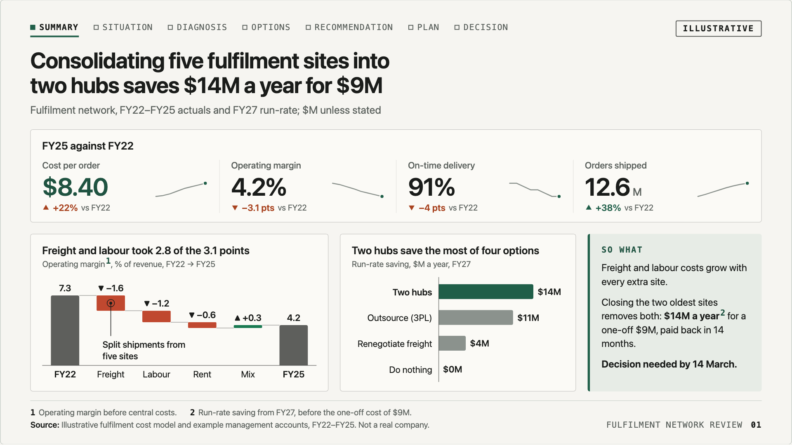
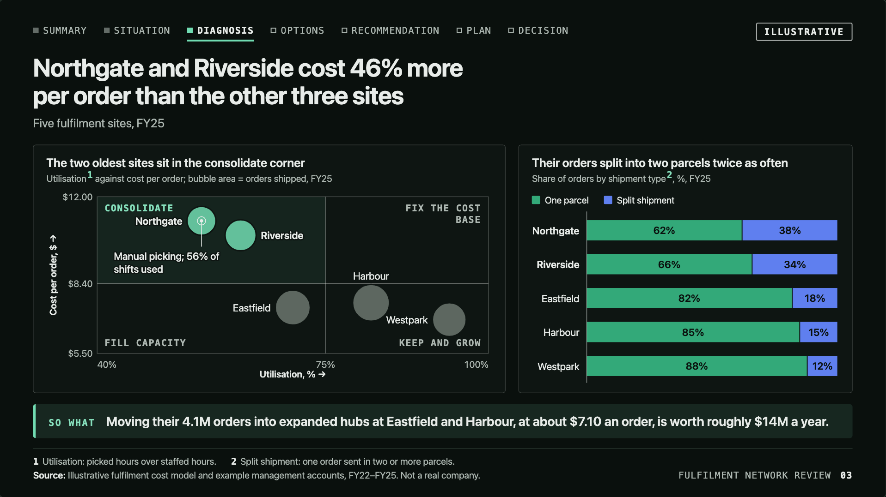

# Consulting slides

`uipack/deck` includes parts for information-dense slides in the strategy-consulting style: a lot of evidence on one page, still readable when projected. Each slide carries one full-sentence claim, the panels that prove it, a "so what", and footnotes with a source. They play in the [deck player](deck.md) like any other slide. Morph and zoom work on them too, so you can zoom from a dense slide into one panel.

Run `npm run dev` and open `/deck?deck=consulting` to see the example: a seven-slide decision request with illustrative data.



```tsx
import { ConsultingSlide, Panel, SoWhat, KpiTiles, Waterfall, BarChart, Ref, formatter, type DeckSlide } from "uipack/deck";
import "uipack/deck.css";

const slide: DeckSlide = {
  id: "summary",
  title: "Two hubs save $14M a year",
  headline: "Consolidating five sites into two hubs saves $14M a year for $9M",
  role: "answer",
  render: () => (
    <ConsultingSlide
      tracker={{ sections: ["Summary", "Situation", "Options", "Decision"], current: "Summary" }}
      sticker="Illustrative"
      title="Consolidating five sites into two hubs saves $14M a year for $9M"
      subtitle="Fulfilment network, FY22–FY25; $M unless stated"
      rows="auto minmax(0, 1fr)"
      notes={["Operating margin before central costs."]}
      source="Fulfilment cost model, FY22–FY25"
    >
      <Panel title="FY25 against FY22" cols={12}>
        <KpiTiles items={[{ label: "Cost per order", value: "$8.40", delta: { text: "+22%", direction: "up", sentiment: "bad" } }]} />
      </Panel>
      <Panel title="Freight and labour took most of the fall" unit={<>Operating margin<Ref n={1} />, %</>} cols={5}>
        <Waterfall steps={[{ label: "FY22", value: 7.3, total: true }, { label: "Freight", value: -1.6 }, { label: "FY25", total: true }]} />
      </Panel>
      <Panel title="Two hubs save the most" unit="$M a year" cols={4}>
        <BarChart format={formatter({ prefix: "$", suffix: "M" })} data={[{ label: "Two hubs", value: 14, highlight: true }, { label: "Do nothing", value: 0 }]} />
      </Panel>
      <SoWhat cols={3}>Closing the two oldest sites removes both costs.</SoWhat>
    </ConsultingSlide>
  ),
  notes: { say: "…", delivery: "…", next: "…" },
};
```

## The frame

| Part | What it is |
| --- | --- |
| `ConsultingSlide` | The dense frame on the 1920×1080 canvas. Props: `tracker`, `title` (the action title, at most two lines), `subtitle` (unit and period), `sticker`, `takeaway` (a "So what" strip under the body), `notes` (numbered footnotes), `source`, `label` (deck name beside the page number), `rows` (`grid-template-rows` of the 12-column body). |
| `Tracker` | The section breadcrumb along the top. The current section has a filled square, bold text and an underline, so colour is never the only cue. Sections before it get a filled grey square. |
| `Panel` | A titled box in the grid: `title`, `unit`, `callout` (a short highlighted note at the top right), `cols`/`rows` (spans), `col`/`row` (start), `emphasis`, and `morphId`, which makes it a `Morph` so a `{ zoom: morphId }` slide opens out of it. |
| `SoWhat` | The conclusion as a grid column. Use `takeaway` for a strip under the body instead. |
| `Ref` | A footnote marker matching the `notes` numbering. |

Panels in a row share the same height because the grid stretches them. Text inside a slide is never smaller than 20 canvas px, about 14px when the canvas is shown 1366 wide. `test/deck-consulting.test.tsx` checks every font size in `consulting.css` and every SVG label on the example deck. `e2e/deck-consulting.spec.ts` also checks the rendered sizes, that titles stay within two lines and that no panel overflows.

To carry a number from one slide into the next one's title, give the KPI tile a `morphId` and wrap the same number in the title with `<Morph id as="span">`. Set the second slide's transition to `"morph"`. `ConsultingSlide` wraps the rest of the title in spans, so the words fade while the number travels.

## Charts

Every chart takes plain data and draws static SVG sized to its panel; pass `width`/`height` to fix the size. Labels sit on the data rather than in a legend, except for stacked bars, whose legend uses square swatches. Every mark has a native tooltip and the SVG has a text summary as its accessible name. Marks grow in when the slide arrives or its `Build` step is reached. Thumbnails, previews and reduced motion show the chart already drawn.

| Chart | Use it for | Key props |
| --- | --- | --- |
| `BarChart` | Ranked comparison (horizontal) or a few columns (vertical) | `data` (`label`, `value`, `highlight`), `orientation`, `sort`, `format`, `domain`, `reference` (an average or target line), `callout` |
| `Waterfall` | A bridge from a start total through changes to an end total | `steps` (`total` or a signed `value`; an end `total` without a value closes at the running level), `goodDirection` (`up` for margin, `down` for cost), `domain` (a start above 0 truncates the totals and marks the break), `callout` |
| `StackedBar` | Composition, absolute or 100% | `categories`, `series` (up to four), `mode`, `orientation`, `format`, `segmentFormat`, `totals` |
| `LineChart` | One to four series over time | `x`, `series` (`highlight` for emphasis), `reference`, `domain`, `annotate` (one point), `tickFormat` |
| `KpiTiles` | Headline numbers | `items` (`label`, `value`, `unit`, `delta` with direction and sentiment, `note`, `trend` sparkline, `morphId`, `highlight`), `columns` |
| `HarveyTable` | Options against criteria, or any short text table | `columns` (`harvey` 0–4 or `text`), `rows` (`highlight` with a `tag`, `detail`), `showKey`, `keyNote` |
| `Matrix2x2` | Items placed on two axes, sized by a third | `x`/`y` (`label`, `domain`, `split`, `format`), `points` (`size`, `highlight`, `labelAt`), `quadrants`, `focus`, `callout` |
| `Annotation` | A note with a leader line that ends on a data point | Usually through a chart's `callout`/`annotate` prop: text offset `dx`/`dy` from the point, `width`, `align` |

The maths is exported and unit-tested: `linearScale`, `niceTicks`, `bandLayout`, `waterfallBars`, `stackSegments`, `harveyWedge`, `bubbleRadius`, `barPath`, `spreadLabels`, `wrapToWidth`, `annotationGeometry` and `formatValue`, which uses a true minus sign.

## Colour

Colour does one job per chart:

- **Emphasis** (the default): the highlighted bar, line or bubble uses the accent (forest in light, mint in dark) and the rest use a context grey.
- **Categorical** (stacked bars, lines without a highlight): four slots that pass the dataviz validator on the panel surface in both themes. The worst adjacent CVD ΔE is 22.7 in light and 21.7 in dark. Light uses `#1a7a52 #4f6fe6 #c27a1f #9a63e0`; dark uses `#33a979 #5f7fef #c0832b #9f72e6`. Values inside segments use white or ink, whichever clears contrast. Fold a fifth series into "Other".
- **Good and bad** (waterfall deltas, KPI deltas): green and red-orange. Their CVD separation sits in the 6–8 warning band, so direction also shows as a ▲/▼ arrow and a signed value. A cost bridge sets `goodDirection="down"`.

The tokens are `--uipack-cx-*` on `.uipack-cx-slide`. The dark set applies to the dark theme and to `ink`-tone slides.



## Limits

- Text widths for chart layout are estimated rather than measured. Very long category labels wrap to two lines and then overflow. Keep labels short or widen the panel.
- Annotation placement is manual (`dx`/`dy`). Check each one in both themes.
- `Matrix2x2` doesn't move labels apart; set `labelAt` per point.
- There's no hover crosshair or table view. Each SVG's accessible name lists its values, and the native tooltips show each mark's value.
