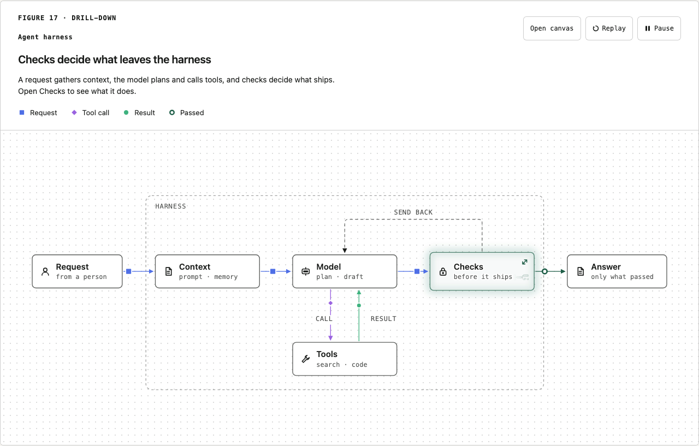
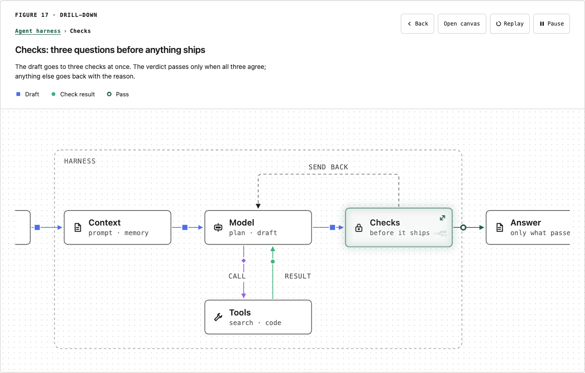
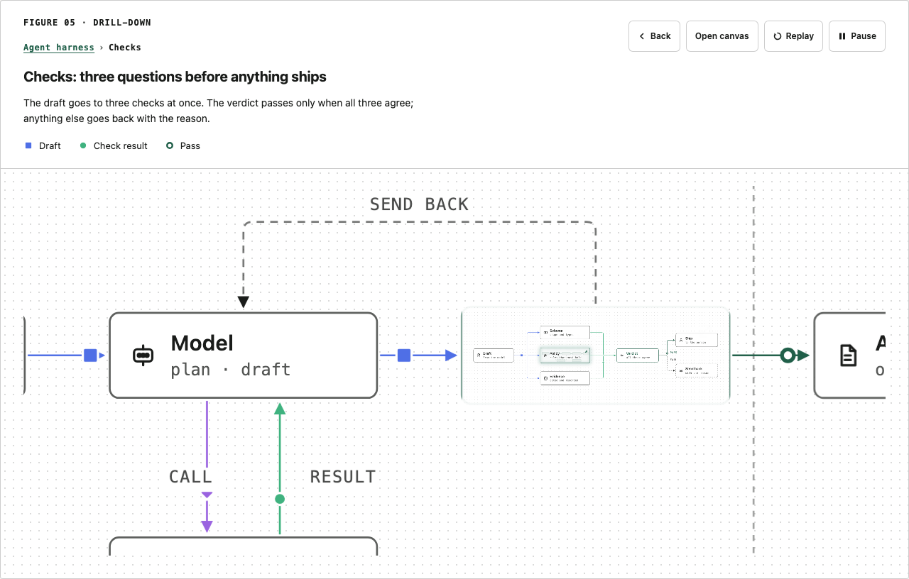
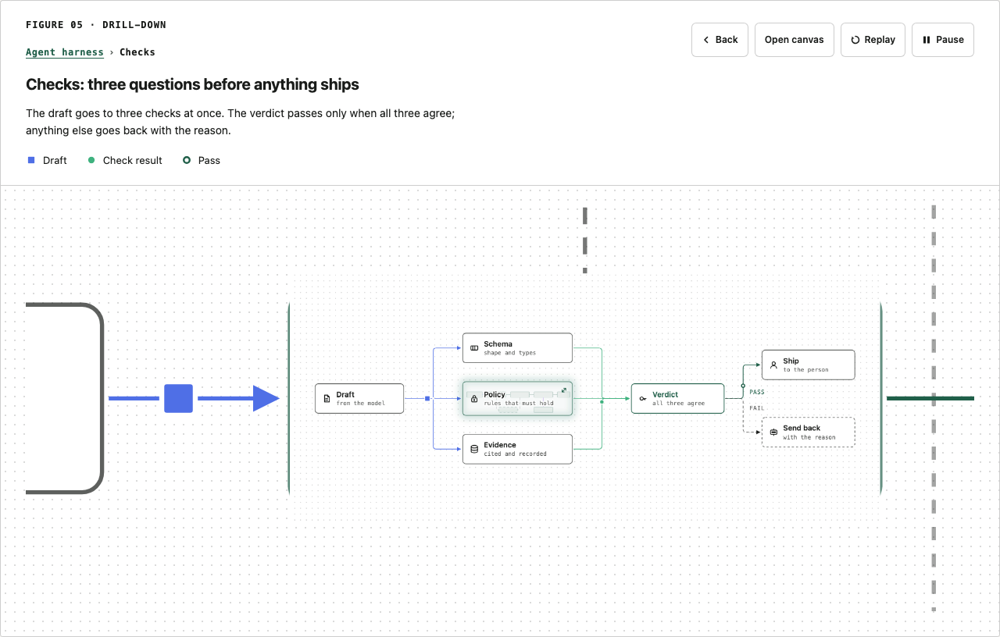
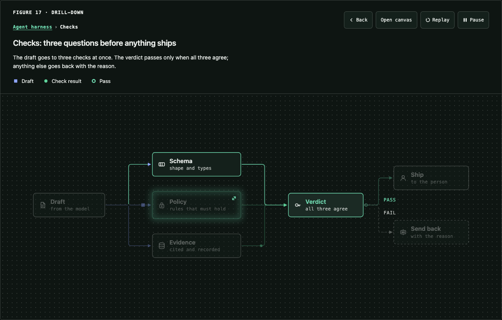
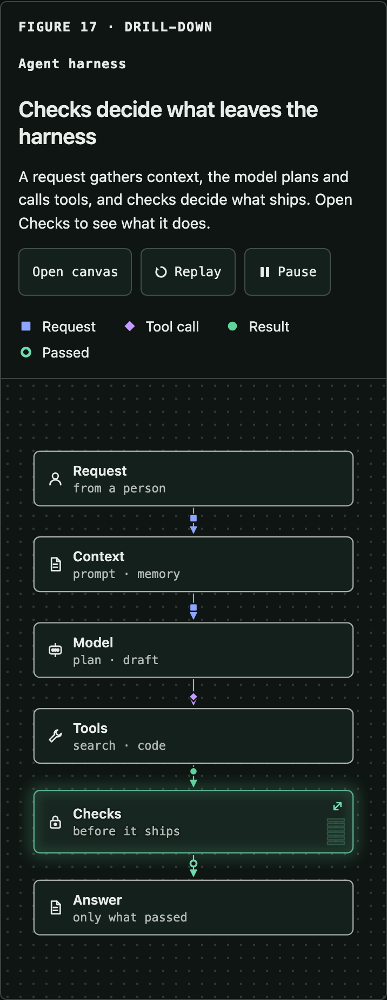

# Drill-down figures

`DrillFigure` is a stack of figures in the Technical Figure style. A `DrillNode` inside one level opens the next: the parent zooms into the node while the child opens from a clip shaped like the node box and grows to fill the canvas. Back plays the same path in reverse. Import both from `uipack`; styles come with `uipack/theme.css`.



## Use

```tsx
import { Defs, DrillFigure, DrillNode, Node, type DrillLevel } from "uipack";

const levels: DrillLevel[] = [
  {
    id: "harness",
    label: "Agent harness", // breadcrumb, button name, announcement
    title: "Checks decide what leaves the harness", // heading; defaults to label
    caption: "Open Checks to see what it does.",
    alt: "A request flows through context and a model into checks.",
    render: (ctx) => (
      <>
        <Defs id={ctx.id} />
        <Node x={232} y={188} w={176} h={56} label="Context" />
        <DrillNode x={696} y={188} w={176} h={56} drill="checks" sub="before it ships" icon="lock" />
      </>
    ),
    narrow: (ctx) => <>{/* optional stacked drawing for < 720px */}</>,
  },
  { id: "checks", label: "Checks", alt: "…", render: (ctx) => <>…</> },
];

<DrillFigure levels={levels} viewBox="0 0 1120 480" narrowViewBox="0 0 360 600" number="Figure 01" eyebrow="Drill-down" />;
```

Levels are a flat list; the first is the root unless `root` names another. Parent and child are linked by `DrillNode drill="<level id>"`, so one level can open several children.

| Prop | Meaning |
| --- | --- |
| `levels`, `root` | The levels and the root id. |
| `viewBox`, `narrowViewBox` | The stage frame every level is drawn into, wide and below 720px. A level may set its own `viewBox`; a different aspect is letterboxed. Author all levels in the same frame for the cleanest zoom. |
| `path`, `onPathChange` | Controlled path of ids from the root (`["harness", "checks"]`). A URL, a deck slide or a parent component can drive it. Invalid tails are dropped. |
| `defaultPath` | Starting path when uncontrolled. |
| `number`, `eyebrow`, `headingLevel`, `expandable`, `controls`, `theme`, `background`, `minFont`, `id` | As on `Figure`. |
| `duration` | Zoom length in ms, default 1000. |

`ctx` passed to `render` carries `id` (prefix every SVG id with it; it is unique per level, drawing and preview, so two levels mounted during a move never collide), `variant` (`"wide"` or `"narrow"`), `ghost` (true when drawn as the preview inside the parent's node) and the `level`.

`DrillNode` takes every `Node` prop except `href`, plus `drill`, optional `label` (defaults to the child level's label), `grow` (height step, default 8 units about the centre: a 56-unit box draws 64) and `preview` (default true). Attach connectors to the drawn box: `drillBox(box)` returns it. Outside a `DrillFigure` it renders a plain `Node`.

Pure helpers are exported for hosts and tests: `drillReducer` (open, up, to depth, set), `normalizeDrillPath`, `drillMove` (in, out, jump), `drillFocusTarget` and `drillAnnouncement`. The zoom maths lives in `src/zoom-math.ts` (`zoomFrame`, `innerClipStart`, `zoomSamples`), shared with the deck player's zoom.

## Affordance

A drillable node is one size step taller, has a soft accent halo and a faint inner glow, a `⤢` marker at its top-right, and a faint schematic of the child level inside: its boxes and lines at one screen pixel, no words, clipped to the node, `aria-hidden` and not interactive. When the node is small against the stage, the schematic is exactly the first frame of the zoom (the child at 1/Z, centred), so the preview hands over to the opening child without a jump. When the node is nearly as wide as the stage (a narrow column), it is a 30% miniature at the right instead. Labels keep a surface-coloured outline so the preview never lowers their contrast. Hover and focus brighten the halo and preview. Non-drillable nodes are unchanged.

Glow here means "there is more inside". Selection keeps its own crisp accent ring.

## Motion

The zoom is one scale about a fixed point F (see `zoomFrame`): the parent scales by Z^p and the child by Z^(p−1), eased in log space, so the child stays locked inside the node box while its clip (with the node's corner radius) opens to the whole stage. The node's words, icon and preview fade as the child appears; the halo leaves first so it never balloons; the parent fades in the last few percent so no magnified border shows at the edges. Back reverses the same keyframes. Back during a move reverses it from where it is; any other change finishes the current move and starts the next. A jump of more than one level (a breadcrumb two levels up, a new URL) crossfades.

Reduced motion replaces every move with a 160ms crossfade, no scaling. Without Web Animations (jsdom, old engines) levels swap instantly.

## Interaction and accessibility

- A drillable node is a button named `Open Checks: 7 parts inside` (the count comes from the child drawing; `summary` on the level overrides it). Click, tap, Enter or Space opens it.
- The header carries a breadcrumb (`Agent harness › Checks › Policy`; ancestors are buttons), the level's heading and caption, Back, Open canvas and the motion controls.
- Escape (after clearing any selection) and Backspace go up one level. In the canvas, Escape keeps closing the canvas; Backspace and Back still go up.
- Focus lands on the new level's heading after going down, and on the node you came from after going up. A polite live region announces `Opened Checks. Agent harness › Checks` or `Back to Agent harness`.
- Selection notes, hover flows and the font floor work inside every level. Selection and hover clear on every move.
- Open canvas shows the current level with zoom and pan; drilling works inside it.
- Below 720px each level's `narrow` drawing is used with the narrow frame. Without narrow drawings the stage keeps a readable 800px width and scrolls inside the figure.

## Static export

`renderStatic(<DrillFigure … />)` (from `uipack/static`) draws the level at `path` or `defaultPath`, with the breadcrumb in the eyebrow and the drill affordance (halo, inner glow, preview, marker) drawn statically and no buttons. `drillStatic(props, path)` returns the same as a `{ children, viewBox, … }` object. The static preview keeps the child's tiny text, because the CSS that reduces it to a schematic is not part of a standalone SVG.

## Example

`playground/DrillSection.tsx`: an illustrative three-level agent harness (Harness → Checks → Policy), wide and narrow, with its path in `?drill=harness/checks`. It is the drill-down section of the diagrams page (`/#drill-figure`); `/drill` opens that page scrolled to it.







## Limits

- Levels with different aspect ratios letterbox inside the stage, and the preview hand-over is exact only for the frame aspect.
- A jump of several levels crossfades rather than chaining zooms.
- The leaving level stays in the accessibility tree for the length of a move (about a second) so focus is never dropped mid-flight.
