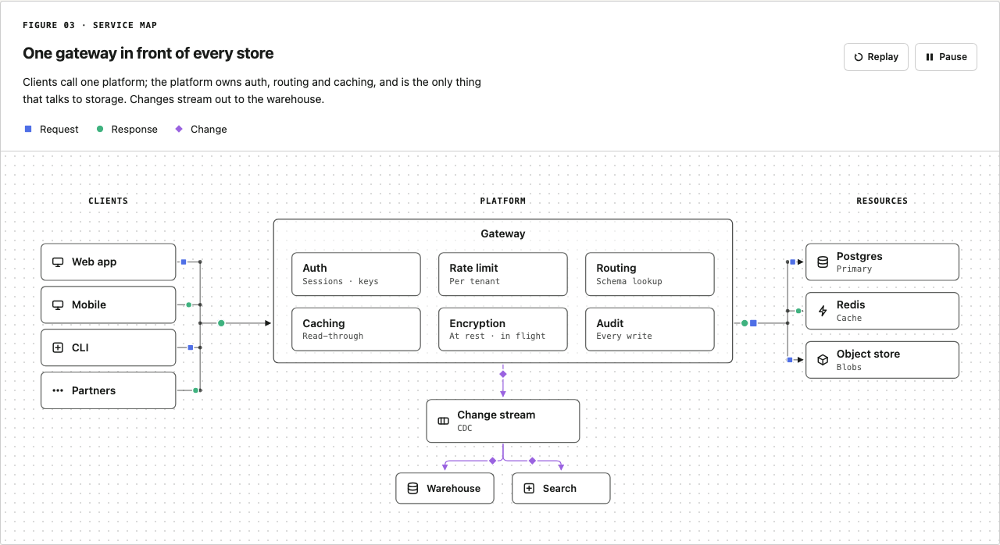
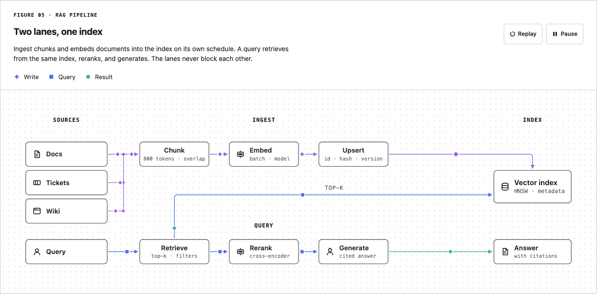
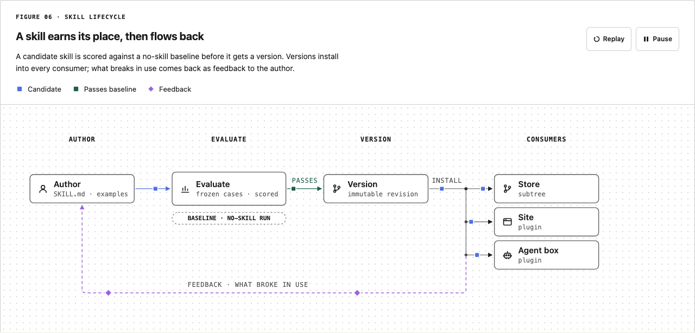
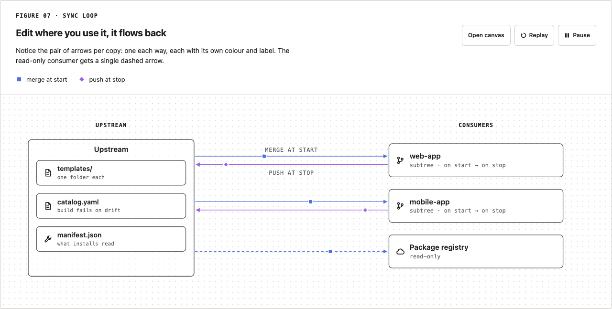
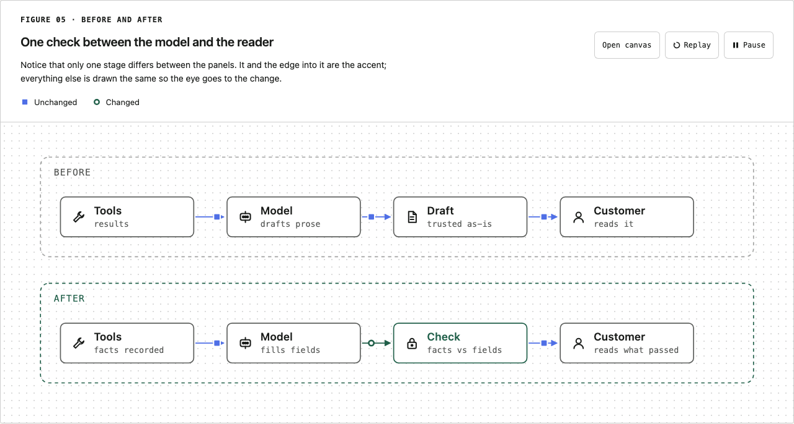
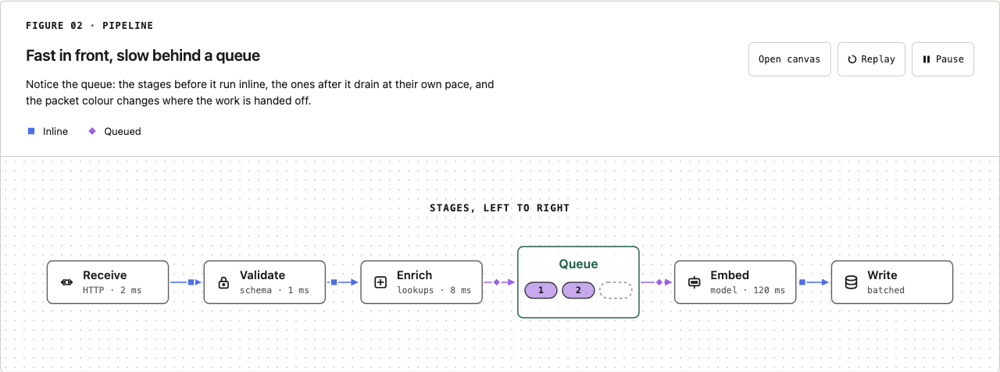

# Figure parts API

The reference for drawing a figure by hand with `uipack`: every part and its props, the connector
rule, hover, motion and the text floor, theming, the seven presets in `uipack/presets` and static
SVG export with `uipack/static`. Read the [diagram rules](system/style.md) and the
[Architecture diagrams](diagrams.md) first to pick a pattern; come here for the exact props.

| You need | Section |
| --- | --- |
| A part's props (`Figure`, `Node`, `Connector`, `Packet`…) | [Parts](#parts) |
| Where arrowheads and packets go | [The connector rule](#the-connector-rule) |
| Hover and flow highlighting | [Interaction](#interaction) |
| Packet motion, Pause and Replay, reduced motion, the 11px floor | [Motion](#motion) |
| Colours in a figure, a site or page theme | [Theming](#theming) |
| User flows and sequences | [Parts](#parts) (user-flow and sequence parts) |
| A ready figure from a typed spec | [Presets](#presets) |
| One SVG file for a README, slide or `` | [Static export](#static-export) |

## Parts

- `Figure`: the frame. Eyebrow, title (`headingLevel` picks the element), caption, legend, Pause and Replay, a canvas with a `background` of `dots`, `plain` or `ruled`, and a `narrow` drawing swapped in below 720px. Owns the SVG timeline, hover and selection state, and optional expanded canvas.
- `Lane`: mono uppercase column header, centred over `x..x+w`.
- `Group`: a boxed service (solid, centred title) or a dashed boundary (mono title).
- `Node`: a box with a label, a mono `sub`, an `icon`, an optional `strip` (`window`, `terminal`, `file`, `store`: a 16-unit header strip naming what kind of box it is; [rules](components/diagrams.md#node-header-strip)), an optional `hint` (one short sentence shown in a note beside the box when it is selected inside a Figure; a native tooltip elsewhere) and `href` (renders as a link with a focus ring). `Chip` and `Group` take the same `hint`.
- `Chip`: a pill for a connection slot, a queued item, a status flag. `shape="tag"` makes it a small-radius box for a symbol or a section (`INTRO`, `PARSE()`); `soft` gives `kind` a lighter wash for the already-stored one beside a full-tint chip.
- `Connector`: a rounded orthogonal path with one arrowhead.
- `Bus`: a trunk with stubs and a junction dot at each join. `busStub` and `busStubs` give the same points to packets.
- `Packet`: a token that rides a connector's points, looping. It pops out slightly as it leaves (0 to 1.2 to 1 over 0.28 s) and shrinks away as it arrives (0.32 s, accelerating), on the motion's own clock, so Pause and Replay hold it too; `emerge={false}` keeps a constant size.
- `TreeRail`, `FolderMark`, `FileMark`, `Sheet`: a file tree. A trunk with square elbows and a junction dot at each child row; folder and page marks; a file as a card with its name as a tracked mono eyebrow, a title and note, and its contents under a dotted rule.
- Figures wash in once, top down, when they scroll into view (about 0.6s, blur to sharp); reduced motion, static export and above-the-fold figures show at once, and `<html data-uipack-entrance="off">` turns it off. `Sheet` takes `flow` and `hint` like a Node; `Lane` takes `flow` so it fades with its column; Sankey bands and bars start a hover.
- `CurvePlot`: one annotated curve: arrowed axes with tracked mono titles and end labels instead of ticks, a monotone smooth curve (it never overshoots a plateau), pinned mono callouts, an accent ring for the highlighted point and a bracket measuring what remains. `curveAt` reads the drawn curve's y at any x.
- `Badge`, `Label`, `Legend`, `Token`, `Defs`: step numbers, text with an underlay, the key, the shape itself, the arrowhead markers.
- `Wall`: solid slabs with a gap at each of its `holes`, standing (`axis="v"`) or lying (`"h"`); one layer of a layered-checks figure. `wallSegments` gives the runs.
- User-flow parts: `Actor` (`cx`, `cy`, `role`, `sub?`, `labelSide?`), `Screen` (`x`, `y`, `w`, `h?`, `title`, `lines?`, `accent?`), `Action` (`x`, `y`, `w`, `h?`, `label`, `sub?`), `Decision` (`cx`, `cy`, `r?`, `label`), `Outcome` (`x`, `y`, `w`, `h?`, `label`, `sub?`), `LaneRule` (`x1`, `x2`, `y`). Each takes `flow`.
- Sequence parts (participants are `Node`s): `Lifeline` (`x`, `y1`, `y2`), `Activation` (`x`, `y1`, `y2`, `accent?`), `Message` (`id`, `from`, `to`, `y`, `n?`, `label`, `kind?`, `dashed?`, `accent?`, `labelX?`, `packet?`), `Lost` (the same, ending in a `Cross`), `SelfLoop` (`id`, `x`, `y`, `h?`, `w?`, `side?`, `n?`, `kind?`, `packet?`), `Note` (`x`, `y`, `w`, `h`, `title`, `lines?`, `accent?`). [When to use each](components/diagrams.md#user-flow-and-sequence-parts).
- `Cross`: a ✕ where something stops, such as a lost message at the end of a dashed `Connector` with `arrow={false}`.
- `icons`: line glyphs in a 16px box (db, cache, queue, service, client, blob, agent, doc, model, tool, gateway, lock, key, clock, cron, browser, terminal, git, cloud, region, user, check, robot, chart, warning, more…). `marks`: my own marks for the tool family, plus `Wordmark` (`size?`, `live?`, `liveColor?`): the UiPack mark and the name. `live` (a `MarkCell`, 0 to 3 in reading order) moves the mark's dot to that cell and `liveColor` colours it (default the ink); every cell then carries `data-cell` and the dot `data-live`, so a host's CSS can move the dot. Without `live` it draws the one mark, the dot bottom right. The docs site's header uses it to show the page's section ([docs-site spec](specs/docs-site.md#navigation)).
- Geometry: `anchor`, `route`, `pathFromPoints`, `pointAlong`, `trim`, `polylineLength`, `grid`.

## The connector rule

One connector, one arrowhead, at the end, in the request direction. The response is the same points ridden backwards by a `Packet` with `reverse`. Two different relations between the same boxes (pull and push, say) are two connectors 16 units apart. A stub that joins a bus carries no arrowhead; the junction dot marks the join, and only a stub that enters a node gets a head.

Connectors stop 2 units short of their first and last point, and 4 short at the arrow end, so a head never touches a border. Packets start `r + 2` units after the source end and stop 12 before the arrowhead end, measured in the connector's own direction whichever way the packet rides, so a token never overlaps a border or a head. The browser suite checks both on every drawing in the playground.

## Interaction

Hover is opt-in and CSS-driven. Give parts a `flow` name (a string or a list): hovering a `Node` with a flow sets `data-hover-flow` on the figure, every element sharing that flow gets `data-state="hit"` (accent stroke, full opacity) and everything else `data-state="dim"` (opacity 0.35), with a 160ms transition. Hovering a legend item does the same by `kind`, so "Response" lights every response line and packet. A node on its own lifts its surface and turns its border accent on hover. Touch devices get none of it (`@media (hover: hover)`), and reduced motion drops the transition.

## Motion

Packets animate with SMIL `animateMotion` (and an `animateTransform` scale for the pop and the shrink). I picked SMIL over CSS `offset-path` because `Figure` can then drive the whole SVG timeline with `pauseAnimations()` and `setCurrentTime(0)`, which is what Pause and Replay do; every packet keeps its offset after a replay and nothing needs JavaScript per frame. Chromium and WebKit both pass the browser suite on it.

Under `prefers-reduced-motion: reduce` a packet renders once at `at` and never moves, and the controls disappear. `at` defaults to `(0.5 + delay / dur) mod 1`, so packets that share a path spread out instead of stacking on the midpoint. Server rendering also produces the static token; motion starts after mount.

### Text floor

`Figure` takes `minFont` (default 11 CSS px). It measures the width each drawing renders at with a ResizeObserver (1088 assumed before that, and on the server) and turns the floor into user units from the viewBox width, so Node, Lane, Label, Chip, Badge and Group never draw text under 11px however wide the viewBox is. Pass `measuredWidth` when you know the width up front, or `minFont={0}` to turn the floor off. A host that draws figures scaled down with a transform (a thumbnail, a gallery card) wraps them in `FigureLayoutWidthContext.Provider value={designWidth}`, so the floor reads the width they lay out at rather than the scaled one; a Figure's own `measuredWidth` wins.

## Theming

The figure root (`.uipack`) reads every colour and face through a private `--uipack-*` name in
`src/theme.css`. Each reads a [diagram theme](components/diagrams.md#diagram-themes)'s carrier
first and the page's `--ui-*` role second (`--uipack-fg` is
`var(--uipack-diagram-ink, var(--ui-ink))`). With no theme, a figure takes the active style's
values: Technical by default, another registered style through `uiStyle` or `data-ui-style`
([style contract](system/style.md)).

A site or page colours its figures with one theme object:

```tsx
// app/layout.tsx (Next.js): the site default, both modes, in the server HTML
import { defineDiagramTheme, diagramThemeCss } from "uipack";
import { compoze, siteTheme } from "./diagram-themes"; // each: defineDiagramTheme({ name, light, dark, fonts?, canvas? })

const css = diagramThemeCss(siteTheme, { scope: ":root" }) + diagramThemeCss(compoze);
export default function Layout({ children }) {
  return (<html><head><style dangerouslySetInnerHTML={{ __html: css }} /></head><body>{children}</body></html>);
}
// app/projects/compoze/page.tsx: the page theme wins inside it
<div data-diagram-theme="compoze">…figures…</div>   // or <DiagramThemeScope theme={compoze}>
```

| Export | Does |
| --- | --- |
| `defineDiagramTheme(input)` | Checks a theme (kebab-case `name`, every required colour in `light` and `dark`) and fills `canvas: "grid"` |
| `blueprint` | The built-in theme: Technical's values, the drafting grid, faces from the page; identical to no theme |
| `diagramThemeCss(theme, { scope?, darkSelector?, lightSelector? })` | A stylesheet string: the carriers on `scope` (default `[data-diagram-theme="<name>"]`), and mode rules when the host's dark switch is not `[data-theme="dark"]` |
| `DiagramThemeScope` (`theme`, `mode?`, `className?`, `style?`) | A `display: contents` element with `data-diagram-theme` and the carriers inline (SSR-safe); `mode` holds light or dark for what it wraps |
| `diagramThemeVars(theme)` | The carriers as a style object |
| `diagramColors(theme, mode)` | One mode's colours with the optional roles filled (line weights, accent ink) |

Light and dark: each colour is a `light-dark()` pair resolved by the figure's colour scheme, which
follows `prefers-color-scheme`, `data-theme="dark"` on any ancestor or the figure, a
`darkSelector`, or `DiagramThemeScope mode`. Strokes are `currentColor`, so one accent per figure
does the highlighting.

A host may still set the `--uipack-*` aliases on `.uipack` itself (a rule that loads after uipack's
CSS wins over any theme). That is the pre-0.3.0 bridge; replace it with a theme
([upgrade notes](../CHANGELOG.md)), never hex literals in consumer CSS.

The figure's controls (Open canvas, Pause, Replay: `.uipack__ctl`) have a 6px corner. A host with a
control radius of its own sets `--uipack-ctl-radius` on the figure or an ancestor (the docs site
does: its 4px in a docs page, square inside its square cards).

## Presets

Seven figures from a small typed spec, each with wide and narrow drawings, packets on the flows that matter, and hover flows wired. Import from `uipack/presets`; every preset ships a `default…` spec and a `…Parts()` function if you want the drawing without the frame.

| Preset | Spec | Shape |
|---|---|---|
| `serviceMap` | `clients`, `platform { title, cells, footer? }`, `resources`, `sinks?` | Three lanes, a bus each side, a change stream below. The Habitat shape. |
| `agentLoop` | `user`, `agent`, `tools`, `boundary`, `output` | Request in, tool calls out and results back, a deterministic check before the output. |
| `ragPipeline` | `sources`, `ingest`, `index`, `query`, `stages`, `answer` | Ingest lane on top writing to an index, query lane below reading from it. |
| `skillLifecycle` | `author`, `evaluate { baseline }`, `version`, `consumers`, `feedback` | Author, evaluate against a baseline, version, install everywhere, feedback back. |
| `syncLoop` | `upstream { items }`, `consumers [{ hooks?, plugin? }]` | One upstream, pull and push per consumer, a one-way plugin read. |
| `beforeAfter` | `before { stages }`, `after { stages, changed }` | Two stacked panels; the changed stage and its inbound edge in accent. |
| `pipeline` | `stages`, `queue? { after, depth }` | A line of stages with a queue between two of them. |








`examples/Habitat.tsx` stays as the reference drawing, built from the parts by hand; the diagrams page shows it as the service-map pattern. The page shows the pipeline, before-and-after, sync-loop and agent-loop presets as their patterns; the service-map, RAG-pipeline and skill-lifecycle presets draw shapes the page already covers (the Habitat drawing; a pipeline with a bus fan-in; a loop with a return path), so they are documented here only.

## Static export

`uipack/static` turns a figure into one SVG file with no dependency on the page: every CSS variable
becomes a literal, fonts are declared inline, and the SMIL packets stay in when you want them. Made
for a README, a Markdown site or a slide, where the file goes through `` and `currentColor`
never reaches the drawing.

```ts
import { writeFileSync } from "node:fs";
import { agentLoop } from "uipack/presets";
import { renderStatic } from "uipack/static";

writeFileSync("figure.svg", renderStatic(agentLoop(spec), { theme: "dark", motion: true }));
// A diagram theme, both files from one object:
for (const mode of ["light", "dark"] as const)
  writeFileSync(`figure-${mode}.svg`, renderStatic(agentLoop(spec), { theme: notesTheme, mode }));
```

A diagram theme draws its own canvas ground (`grid`, `dots`, `plain`); the older forms keep the dot
grid. Faces given as `var(--…)` fall back to Technical's stacks in a static file, which cannot read
the page.

| Option | Default | Does |
|---|---|---|
| `theme` | `"light"` | a diagram theme (`blueprint`, `defineDiagramTheme(…)`), or the older `"light"`, `"dark"`, or `{ base, ...overrides }` with any `--uipack-*` key as a literal |
| `mode` | `"light"` | which half of a diagram theme to draw; the older forms carry their own |
| `motion` | `true` | keep `animateMotion` (it runs inside `` in every current browser) or render each packet once at its `at` |
| `frame` | `true` | draw eyebrow, title, caption, legend and the border in SVG; `false` gives the bare drawing |
| `background` | `true` | paint the canvas and its grid; `false` lets the page surface show through |
| `width` | viewBox width | the file's `width` attribute; height follows |
| `minFont` | `11` | text floor in CSS px at the width the file is shown at (1088 when `width` is not given) |

The input is what a preset returns, a `<Figure>` element, or a bare `{ children, viewBox }`. The
asset previews under `docs/assets/` come from the same call, so a preview in the browser and a file
in a README are the same pixels. Tested through `` in Chromium and WebKit: the packets move
when `motion` is on and hold still when it is off.
