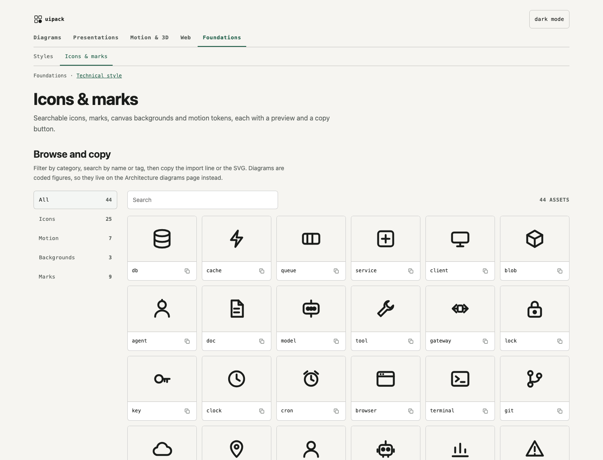

# Icons and marks

Every icon, mark, canvas background and motion token UiPack ships, searchable, each with a
preview and a copy button for its import line or SVG. Diagrams are coded figures, so they live in
the [diagram catalogue](diagrams.md) instead.

## Using an asset

- Filter by category, search by name or tag, then copy the import line or the SVG.
- Icons and marks are drawn from the role layer, so they repaint with the site's spec and theme;
  never recolour one with a raw value.
- The list is `assets/manifest.json` (rebuilt by `npm run manifest`); the package exports it as
  `uipack/assets/manifest.json`, and `AssetBrowser` from `uipack/browser` is the browser below.

## Browse

```uipack-demo asset-browser wide
The asset browser: category filters, search, a preview per asset and copy buttons for the import line and the SVG.
```

## Manifest and AssetBrowser API

`assets/manifest.json` lists every asset with a rendered preview under `docs/assets/` (light palette) and `docs/assets/dark/` (dark palette), and `AssetBrowser` (from `uipack/browser`) shows it: categories with counts down the left, a search box, a grid of cards with the preview on a tile that follows the theme, and one action, which copies the import line or the SVG. Names wrap rather than truncate. When nothing matches, it says what was searched (and in which category) and offers Clear search, Show all assets or Clear filters, which puts focus back in the search box.



```json
{
  "version": 1,
  "generated": "2026-09-16",
  "assets": [
    {
      "id": "icon-lock",
      "name": "lock",
      "category": "Icons",
      "kind": "icon",
      "preview": "docs/assets/icon-lock.svg",
      "previewDark": "docs/assets/dark/icon-lock.svg",
      "source": "<Node … icon=\"lock\" />  // or: icons.lock",
      "tags": ["icon", "lock"]
    }
  ]
}
```

`kind` is one of `icon`, `motion`, `background`, `mark` (the type still accepts `figure` and `part` for older manifests). Today: 25 icons, 7 motion, 3 backgrounds, 9 marks. The diagram presets and parts are coded figures, not assets; see them on the playground's Architecture diagrams page. Marks are my own only; no third-party logos. `npm run manifest` re-renders the previews and rewrites the file.

```tsx
import "uipack/browser.css";
import { AssetBrowser } from "uipack/browser";
import manifest from "uipack/assets/manifest.json";

<AssetBrowser manifest={manifest} initialCategory="Icons" base="/uipack/" />
```

`onAction` replaces the copy, `actionLabel` renames the button. With a mouse (`hover: hover`) a card's button appears on hover or keyboard focus; touch screens always show it. Previews show at the size their file is drawn for (icons and tokens at 48px, marks at 64px, motion strips at 240px capped by the tile); background swatches fill the tile with a hairline edge. An animated preview may list `previewStatic` and `previewStaticDark`, a still the tile shows under `prefers-reduced-motion: reduce` (the packet strip does). The sidebar collapses to a row of chips below 720px; every target is 44px. On wider screens the category list is sticky at `top: 16px`; a host with a fixed header sets `--uipack-browser-sticky-top` (for example `88px`) on `.uipack-browser` or an ancestor. The tile shows `previewDark` when the browser's colour tokens are dark (`data-theme="dark"` on it or an ancestor, or the OS preference without `data-theme="light"`).
