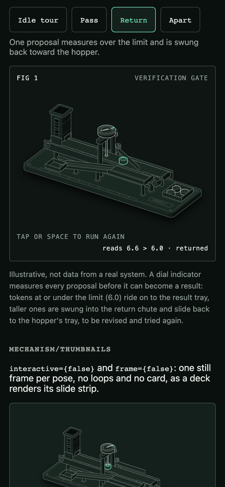

# Mechanism style

`uipack/mechanism` (with `uipack/mechanism.css`) draws one real, well-made isometric machine whose working *is* the concept. Its first machine is the **verification gate**, for an agent-harness talk: an agent proposes actions, and a check stands between a proposal and its result.




The style follows [Anatomy](https://github.com/wheresryan22/anatomy) by Ryan (MIT), pinned at commit `1482e8469b0a9e0d8cc18ea2740a01423d29ae80`: "the object is the explanation". It is drawn in the Technical palette, so it belongs to the same family as the figures.

## When to use it

| Explain | Use |
| --- | --- |
| How **one mechanism** behaves: a check, a cache, a queue, a lock, a retry | Mechanism |
| What connects to what (topology, flows, lanes) | Figures (`uipack`, `uipack/presets`) |
| A camera tour through an architecture | 3D animations (`uipack/slides`) |

One machine per idea. If the explanation needs boxes, arrows or several labelled systems, it is a Figure.

## The verification gate

**What moves and what it means:** a proposal token leaves the hopper on a belt and stops under a dial indicator; the plunger rides up onto it and the needle reads its height against the limit mark at 6.0. A token at or under the limit rides on and drops into the result tray (the action becomes a result). A taller one makes the arm swing across the belt and push it into the chute, which slides it back to the tray beside the hopper (the proposal is returned and revised).

- **Truth first.** `src/mechanism/gate/model.ts` is a small pure model: a deterministic cycle of twelve checks (`checkAt`), the limit (`LIMIT = 6`), the verdict (`verdictOf`), and the tally (`tallyOf`, `checked 12 · passed 9 · returned 3`). Proposals 3, 6 and 9 are returned and pass on their second attempt. The dial, the token heights, the route each token takes and the readout are all read from it. The values are **illustrative, not data from a real system**, and the default caption says so.
- **Parts (about 70).** Base: plate, four feet with flanges, groove, corner screws, ruler strip, label plate. Conveyor: four legs with foot plates, two stretchers, two side rails with lips and a lip ruler with its zero under the gauge, two drums, the belt and its moving slats, a bearing cap, a gear motor with a terminal box. Hopper: magazine with a window onto the stacked proposals, collar, two cheek brackets, exit gate. Gauge: two posts with feet, a beam, a plunger guide, the plunger and its tip, a dial with knurled bezel, crown, 0–10 scale, passing band, limit mark, needle and drag hand. Diverter: bracket, pivot post, hub, rotary head with its pointer and stops, the arm. Return: apron, sloped chute with walls, supports, return tray. Result tray. Up to eight tokens.
- **Tone hierarchy.** Base and feet `lo`, structure `mid`, the dial and tokens `hi`. The one `lit` part is the proposal being checked (forest in light, mint in dark); the only other accent is the limit mark it is judged against. Pass and return are told by route and by the readout, never by colour alone.

## API

```tsx
import { VerificationGate } from "uipack/mechanism";
import "uipack/mechanism.css";

<VerificationGate pose={slidePose} theme="dark" />;
```

| Prop | Default | Meaning |
| --- | --- | --- |
| `pose` | `"idle"` | Controlled. `idle`: the calm idle tour, proposals keep coming and the tally grows. `pass`: one proposal measures 4.2 and reaches the result tray. `return`: one measures 6.6 and is swung back. `apart`: the six assemblies (hopper, gauge, diverter, chute, tray, conveyor) come apart on staggered springs. |
| `theme` | inherit | `"light"` or `"dark"`. Omitted, the machine follows an ancestor's `data-theme="dark"`. |
| `motion` | `"auto"` | `"none"` holds each pose's still frame, as `prefers-reduced-motion: reduce` does. |
| `interactive` | `true` | `false` renders one still frame: no requestAnimationFrame, no IntersectionObserver, no handlers, no tab stop. Use it for deck thumbnails. |
| `frame` | `true` | `false` renders the bare machine, without the card, for a slide that places it. |
| `number`, `title`, `hint`, `caption` | `"Fig 1"`, `"Verification gate"`, per pose, an honest caption | The card's corners and caption (`number` as on `Figure`). |
| `onReadout` | | Called with the readout text whenever it changes (useful with `frame={false}`). |
| `alt` | a description | The SVG's accessible description, as on `Figure`. |

`GateMachine` is the same machine without the frame; `MechanismFrame` is the card on its own (`number`, `title`, `hint`, `readout`, `caption`, `theme`, children), and a machine inside it writes its live readout into the bottom-right corner.

**Pose changes never jump.** Every frame, the machine computes the pose's scripted scene (`sceneAt(pose, t)` in `gate/motion.ts`, a pure function of time) and follows it: tokens ease to their targets (exponential follow, τ 0.05 s) and cross-fade when they leave or join the scene, the plunger, arm and explode shares ride springs, the belt's speed eases. A deck can switch pose mid-run, and the machine moves there from wherever it is. Two instances can be mounted at once (slide transitions): SVG ids come from `useId`, and all state is per instance.

**Motion budget.** One requestAnimationFrame loop per instance, writing attributes through the DOM, never re-rendering React per frame. It runs only while the machine is within 120px of the viewport, stops once a single-run pose or the explode has settled, and holds a still, readable frame under reduced motion (the token under the gauge, the token on its way to the tray, the token being swung off the belt, the machine apart).

**Input.** The machine is one focusable button. Tap, click, Space or Enter: in `idle`, pause or resume; in `pass` and `return`, run again; in `apart`, reassemble or take apart again. The hint corner says which. A polite live region announces phase changes only (paused, running, the verdict), never per-frame numbers.

## Craft rules kept from Anatomy

- Solids, not wireframes: every part is filled in paper colour and painted back to front; sides shaded in four tones by facing, lighter tops, bevels.
- Many small, precise parts, each sitting on another and doing a job; detail comes from structure, not texture.
- Lines resolve: ticks hang from a ruler or a dial edge, seams wrap corners, grooves run edge to edge, slots are closed outlines. Only the label plate's rule lines (printed text) stop on a bare face.
- No words in the drawing; words go in the card corners and caption, in small uppercase mono (at least 11px).
- Calm, time-based motion with exponential follow and real springs; an idle tour; still under reduced motion; stopped offscreen.
- SVG first. This entry has no Three.js, GSAP or WebGL.

## Building a new machine (the Anatomy workflow)

Put each machine in its own folder under `src/mechanism/`, as `gate/` is for the gate (`model.ts`, `view.ts`, `geometry.ts`, `motion.ts`, `VerificationGate.tsx`); `kit/`, `solid3.ts`, `MechanismFrame` and `mechanism.css` are shared. Export it by name from `src/mechanism/index.ts` and register it in `playground/catalog.ts` (`mechanismEntries`). The step-by-step file list is in [contributing](contributing.md#a-new-mechanism-machine).

1. **Size it.** A Figure is one mechanism, 40–80 parts. Larger (a Hero, 80–150) needs a reason.
2. **Truth first.** Write the model as a small pure module with unit tests: the real numbers, thresholds, counts and the readout text.
3. **Invent the object.** A machine whose mechanism maps one-to-one onto the concept. Say in one sentence what moves and what that means.
4. **Parts list (≥ 40),** grouped as base, structure, mechanism, controls and the subject, before any geometry.
5. **Plan the world** in world units (x, y on the floor, z up), plans as rounded rectangles, the camera (azimuth 35–60°, elevation 30°) fitted with `fitProjection` so every pose, apart included, stays in the card.
6. **Build geometry once** with the vendored kit (`slabOf`, `cylinder`, `extrude`, `planOutline`, `topTicks`, `radialTicks`, `knurl`, `sideSeam`…) plus `prismOf` for prisms on any axis (sloped chutes, drums lying down, swinging arms). Moving parts are built at rest and translated; only parts that change shape are rebuilt per frame.
7. **Paint back to front.** Split anything that both hides and is hidden (the gauge has a back post group and a front group; tokens are drawn in three layers: belt, chute, tray). A moving part lives in the slot where it physically sits.
8. **Frame it** in `MechanismFrame`: Fig, title, hint, readout, true caption.
9. **Make it live:** a pure scene-of-time script per pose, followed with springs; one loop; IntersectionObserver; reduced motion; touch and keyboard.
10. **Verify like a critic:** unit tests for the model and the scripts' continuity; Playwright in both themes and both engines; screenshots at 1440 and 390 in both themes and 4× close-ups of every junction; fix bare regions, lines that end on nothing, parts passing through each other and text under 11px.

## Credit and licence

The kit in `src/mechanism/kit/` (`iso-kit.ts`, `draw.tsx`, `live.tsx`) is vendored from [Anatomy](https://github.com/wheresryan22/anatomy) at commit `1482e8469b0a9e0d8cc18ea2740a01423d29ae80`, under the MIT licence, Copyright (c) 2026 Ryan. The full notice is in `src/mechanism/kit/LICENSE`, and each file names its source. The only changes are the import path in `draw.tsx` and the dropped `"use client"` directive in `live.tsx`. The drawing rules in `mechanism.css` are adapted from Anatomy's `ISO_CSS`; the machine, its model, `solid3.ts` and the palette mapping are UI Pack's.
