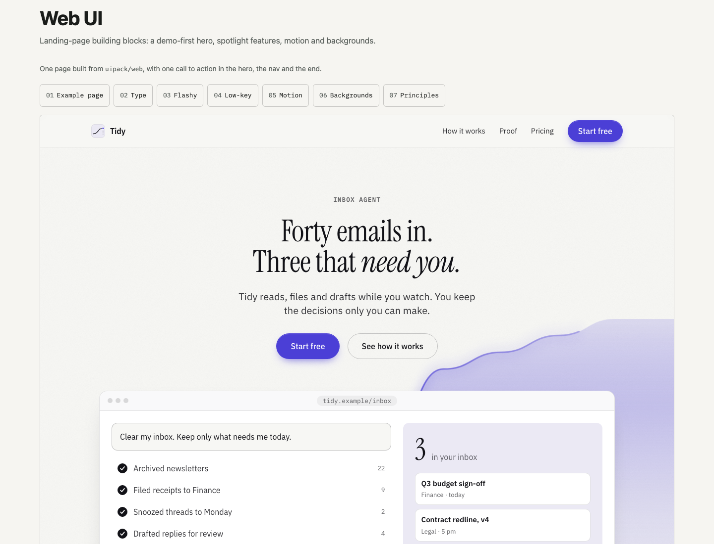
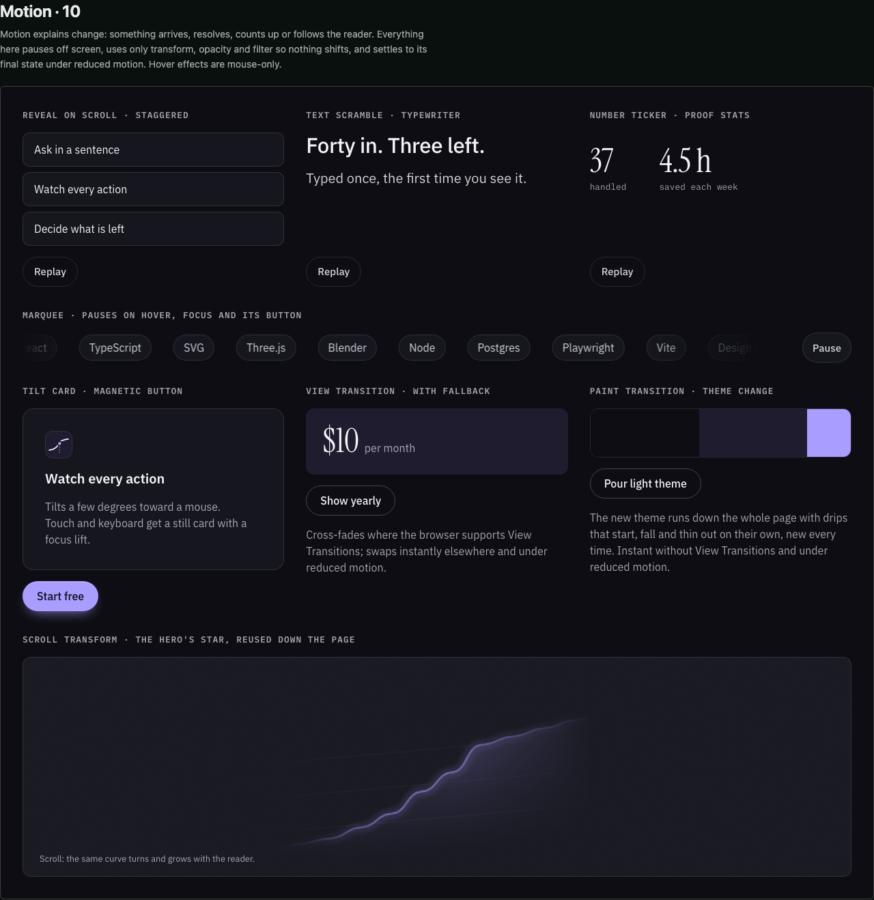
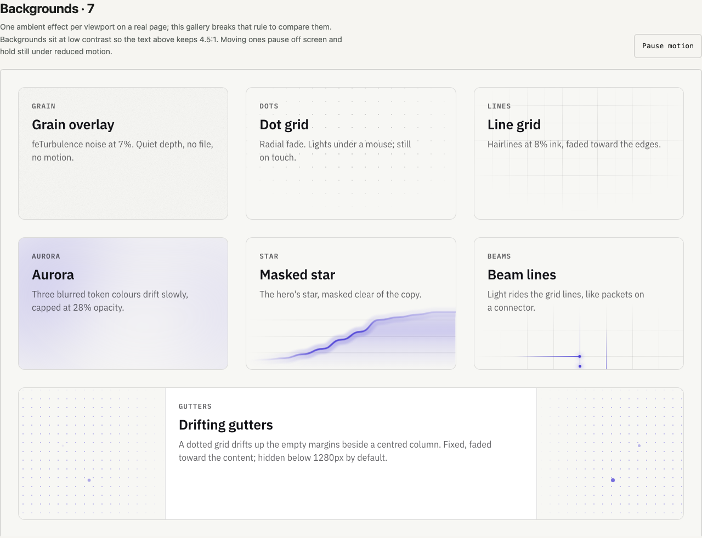

# Web parts API

The reference for `uipack/web` with `uipack/web.css`: the page parts, the motion and background
parts, type, and scoping. To build a page, start from the
[landing recipe](recipes/landing.md) and copy `examples/web-starter`. To check a part's exact
props, look up its props type in [the parts table](#every-part-its-props-type-and-its-file), then
read that type in `dist/web.d.ts` (or the source file named there).
The rules for using these parts are in [web principles](web-principles.md).

`uipack/web` builds web pages in **Technical**, a diagram-led blueprint and the one implemented style. Every site UiPack designs for has one [spec](specs/README.md); Technical is the package's default. A page keeps its own section order, hero and layout; the style's own order is an opt-in, `layout="style"` ([web style](web-principles.md#web-style)). Its building blocks for landing pages and marketing sites are drawn from four design videos and written up as [numbered principles](web-principles.md). The flashy pieces each earn their motion: **DemoPlayer** (a baked-in product demo that types a prompt, ticks through the agent's actions and settles on the result, with Pause, Replay and `01/02/03` step tabs), **StarHero** (one masked focal visual from the product story, with inline SVG noise), **SpotlightCard** (a pointer-following light and border glow, off on touch) and **RevealText** (a scroll-in word reveal). The low-key pieces are the defaults: a 16px × 1.25 type scale, `Eyebrow` / `Heading` / `Subhead` / `Body` with opacity hierarchy, `CtaButton`, a sticky `GlassNav`, and `Section` / `FeatureGrid` on a 12/8/4 grid with icons that rhyme with the hero. The closing parts are components too: `Proof` (the headline number, stats and a named quote), `PricingPlans`, `ClosingCta`, `SiteFooter` and `Brand`.

```tsx
import "uipack/web.css";
import { WebSurface, GlassNav, StarHero, DemoPlayer, CtaButton, type DemoStep } from "uipack/web";

const steps: DemoStep[] = [
  { id: "ask", label: "Ask", title: "Say what you want.", prompt: "Clear my inbox. Keep only what needs me today." },
  { id: "act", label: "Act", title: "Watch it work.", actions: [{ label: "Archived newsletters", metric: 18 }, { label: "Drafted replies", metric: 3 }] },
  { id: "review", label: "Review", title: "Three things need you.", metric: 3, screen: <MyResult /> },
];

<WebSurface theme="dark">
  <GlassNav brand="Tidy" links={[{ label: "Pricing", href: "#pricing" }]} cta={<CtaButton href="#start">Start free</CtaButton>} />
  <StarHero title="Forty emails in. Three that need you." actions={<CtaButton size="lg" href="#start">Start free</CtaButton>}>
    <DemoPlayer label="Product demo" steps={steps} initialMetric={40} metricLabel="in your inbox" />
  </StarHero>
</WebSurface>;
```

**Motion** adds `Reveal` (staggered fade, rise or blur-in on scroll), `TextScramble` (scramble or typewriter, once), `NumberTicker` (counts proof stats up when seen), `Marquee` (pauses on hover, focus, off screen and with its own button), `TiltCard` and `MagneticButton` (mouse-only, subtle), `ScrollTransform` with `useScrollProgress` (reuse the hero's star as the reader scrolls), `withViewTransition` (View Transitions with an instant fallback) and `withPaintTransition(update, { duration })` (a theme change poured down the page as paint with random drips; 750ms by default; injects and removes its own keyframes and holds a `theme-switching` class on `<html>` that freezes element CSS transitions during the pour; instant fallback; wrap React state in `flushSync` yourself). **Backgrounds** add `GrainOverlay`, `DotGrid` and `LineGrid` (radial fade, optional pointer spotlight), `Aurora` (slow blurred token colours under one opacity cap), `MaskedStar` and `BeamLines` (light riding grid lines like packets; `clear="top"` on either keeps it in the lower half of a card whose copy runs full width above); put one in a `BackgroundFrame`. `DriftingGutters` (`contentWidth`, `top`, `minViewport`, `drift`) is the exception: a fixed, page-level dotted grid drifting in the side gutters of a centred column, hidden below 1280px by default and coloured by `--web-gutters-color` (falling back to `--web-accent`); render it once per page, portalled to `<body>` if an ancestor is transformed. A page that uses nothing else from the web entry can import `uipack/web-gutters.css` (about 2 KB) instead of `uipack/web.css`. All of it is CSS, IntersectionObserver and inline SVG: no GSAP, no new dependencies. Moving pieces pause off screen and hold a static equivalent under reduced motion; `data-web-motion="paused"` on any ancestor holds the looping aurora, beams and gutters, so a page can offer its own Pause (WCAG 2.2.2), as `/web`'s Backgrounds section does.

```tsx
<BackgroundFrame background={<DotGrid spotlight />}>
  <Reveal variant="blur">
    <Heading level={2}><TextScramble text="Forty in. Three left." /></Heading>
    <p><NumberTicker value={37} /> handled this morning</p>
  </Reveal>
</BackgroundFrame>
```

Every class and token is scoped under `.uipack-web`; there are no global element rules. Type comes in three self-hosted roles: Technical sets IBM Plex Sans for display (600) and text and IBM Plex Mono for labels and data. They are latin woff2 files in `uipack/fonts/*` (fetched only when the active style uses them, no third-party requests); override `--web-font-display`, `--web-font-text` or `--web-font-mono` to change one. `<SmoothScroll />` is an opt-in, dependency-free Lenis-style wheel easing that moves the real page scroll (off on touch and under reduced motion) and eases in-page anchors below a sticky `GlassNav`; `smoothScrollTo(target, { offset, duration })` scrolls from code. See [type roles and smooth scrolling](web-principles.md#type-roles). Under reduced motion, DemoPlayer holds still on its final state (every step stays in the DOM as text for screen readers and crawlers), and the other pieces render still. `/web` in the playground composes a full example page.





## Every part, its props type and its file

Generated from `src/web/index.ts`. Exact props are in the type, in `dist/web.d.ts` or the source.

<!-- generated:web-parts -->
| Part | Props type | Source |
| --- | --- | --- |
| `WebSurface` | `WebSurfaceProps` | `src/web/Surface.tsx` |
| `Grid` | `GridProps` | `src/web/Surface.tsx` |
| `GridItem` | `GridItemProps` | `src/web/Surface.tsx` |
| `WebPage` | `WebPageProps` | `src/web/WebPage.tsx` |
| `Eyebrow` |  | `src/web/Text.tsx` |
| `Heading` | `HeadingProps` | `src/web/Text.tsx` |
| `Subhead` |  | `src/web/Text.tsx` |
| `Body` | `BodyProps` | `src/web/Text.tsx` |
| `CtaButton` | `CtaButtonProps` | `src/web/CtaButton.tsx` |
| `GlassNav` | `GlassNavProps` | `src/web/GlassNav.tsx` |
| `Section` | `SectionProps` | `src/web/Section.tsx` |
| `FeatureGrid` | `FeatureGridProps` | `src/web/Section.tsx` |
| `SectionIndexContext` |  | `src/web/Section.tsx` |
| `SpotlightCard` | `SpotlightCardProps` | `src/web/SpotlightCard.tsx` |
| `Proof` | `ProofProps` | `src/web/Blocks.tsx` |
| `PricingPlans` | `PricingPlansProps` | `src/web/Blocks.tsx` |
| `ClosingCta` | `ClosingCtaProps` | `src/web/Blocks.tsx` |
| `SiteFooter` | `SiteFooterProps` | `src/web/Blocks.tsx` |
| `Brand` | `BrandProps` | `src/web/Blocks.tsx` |
| `ProductWindow` | `ProductWindowProps` | `src/web/ProductMock.tsx` |
| `DataTable` | `DataTableProps` | `src/web/ProductMock.tsx` |
| `ScheduleGrid` | `ScheduleGridProps` | `src/web/ProductMock.tsx` |
| `ItemList` | `ItemListProps` | `src/web/ProductMock.tsx` |
| `RecordCard` | `RecordCardProps` | `src/web/ProductMock.tsx` |
| `FileTable` | `FileTableProps` | `src/web/ProductMock.tsx` |
| `ProductShot` | `ProductShotProps` | `src/web/ProductShot.tsx` |
| `WorkedExample` | `WorkedExampleProps` | `src/web/Worked.tsx` |
| `BeforeAfter` | `BeforeAfterProps` | `src/web/Worked.tsx` |
| `RevealText` | `RevealTextProps` | `src/web/RevealText.tsx` |
| `StarHero` | `StarHeroProps` | `src/web/StarHero.tsx` |
| `StarChart` | `StarChartProps` | `src/web/motif.tsx` |
| `RhymeIcon` | `RhymeIconProps` | `src/web/motif.tsx` |
| `NoiseLayer` |  | `src/web/motif.tsx` |
| `DEFAULT_STAR_VALUES` |  | `src/web/motif.tsx` |
| `DemoPlayer` | `DemoPlayerProps` | `src/web/DemoPlayer.tsx` |
| `DEFAULT_TIMING` |  | `src/web/timeline.ts` |
| `TYPE_FACES` |  | `src/web/tokens.ts` |
| `DISPLAY_FROM_STEP` |  | `src/web/tokens.ts` |
| `TYPE_BASE_PX` |  | `src/web/tokens.ts` |
| `TYPE_RATIO` |  | `src/web/tokens.ts` |
| `TYPE_STEPS` |  | `src/web/tokens.ts` |
| `EMPHASIS` |  | `src/web/tokens.ts` |
| `SPACE` |  | `src/web/tokens.ts` |
| `GRID_COLUMNS` |  | `src/web/tokens.ts` |
| `BackgroundFrame` | `BackgroundFrameProps` | `src/web/backgrounds.tsx` |
| `GrainOverlay` | `GrainOverlayProps` | `src/web/backgrounds.tsx` |
| `DotGrid` |  | `src/web/backgrounds.tsx` |
| `LineGrid` |  | `src/web/backgrounds.tsx` |
| `Aurora` | `AuroraProps` | `src/web/backgrounds.tsx` |
| `MaskedStar` | `MaskedStarProps` | `src/web/backgrounds.tsx` |
| `BeamLines` | `BeamLinesProps` | `src/web/backgrounds.tsx` |
| `DriftingGutters` | `DriftingGuttersProps` | `src/web/backgrounds.tsx` |
| `Reveal` | `RevealProps` | `src/web/motion.tsx` |
| `TextScramble` | `TextScrambleProps` | `src/web/motion.tsx` |
| `NumberTicker` | `NumberTickerProps` | `src/web/motion.tsx` |
| `Marquee` | `MarqueeProps` | `src/web/motion.tsx` |
| `TiltCard` | `TiltCardProps` | `src/web/motion.tsx` |
| `MagneticButton` | `MagneticButtonProps` | `src/web/motion.tsx` |
| `ScrollTransform` | `ScrollTransformProps` | `src/web/motion.tsx` |
| `SmoothScroll` | `SmoothScrollProps` | `src/web/SmoothScroll.tsx` |
| `WHEEL_LINE_PX` |  | `src/web/SmoothScroll.tsx` |
| `WHEEL_PAGE_FRACTION` |  | `src/web/SmoothScroll.tsx` |
| `SMOOTH_SCROLL_ATTR` |  | `src/web/SmoothScroll.tsx` |
| `SMOOTH_SCROLL_PREVENT_ATTR` |  | `src/web/SmoothScroll.tsx` |
| `WEB_FONT_FILES` |  | `src/web/seo.ts` |
| `HeadTags` | `HeadTagsProps` | `src/web/Head.tsx` |
| `JsonLd` | `JsonLdProps` | `src/web/Head.tsx` |
| `FAQ` | `FAQProps` | `src/web/FAQ.tsx` |
| `LLMS_FULL_PATH` |  | `src/web/crawl.ts` |
| `AI_CRAWLERS` |  | `src/web/crawl.ts` |
<!-- /generated -->
